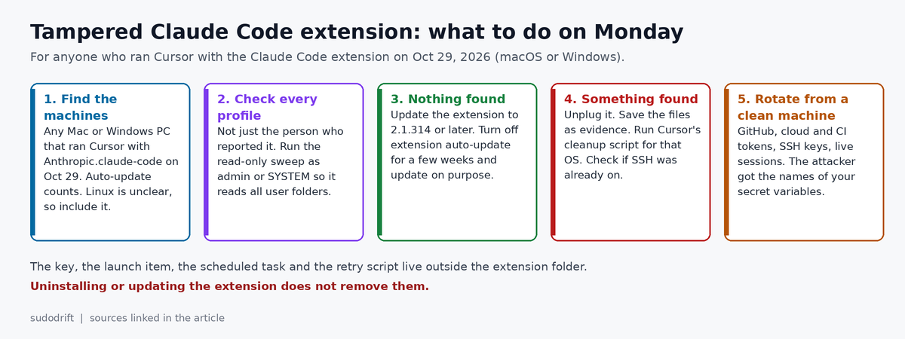
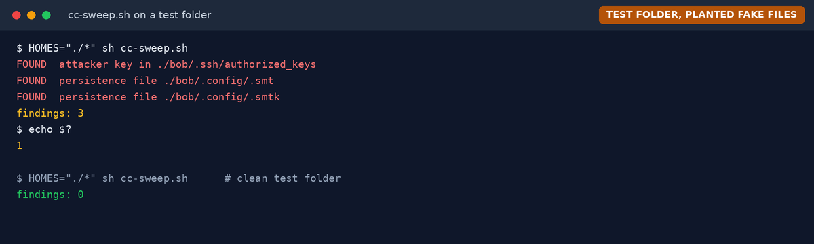

*By sudodrift*

On Thursday, the AI coding assistant a lot of developers trust with their whole repo turned into an SSH backdoor for part of a day. Nobody's model went rogue. Someone got a poisoned copy of the extension into the store, and auto-update did the rest.

Most write-ups already give you the one-line check. It's a good check. But it only looks at the account you're logged in as. I look after endpoints for a living, and that's not how shared Macs, lab machines or build boxes work. So this post is about checking the whole machine, and then the whole fleet, with two small read-only scripts.

## What happened

Cursor posted a security notice on Oct 29. Between about 2:27 AM and 1:35 PM Pacific time (5:27 AM to 4:35 PM in Toronto), a maliciously modified `Anthropic.claude-code` extension was served from the Cursor VS Code Extension Marketplace. Cursor's notice, updated Oct 30, names versions 2.1.312 and 2.1.313 for Windows and macOS ([Cursor notice](https://cursor.com/blog/claude-code-extension-security-notice)).

Cursor says the code:

- collected host details (hostname, username, OS, home folder, the names of environment variables, Git email, public IP) and sent them to a server at 134.209.82.225
- added an attacker SSH key, labelled `svc-telemetry`, to `authorized_keys`
- tried to switch on SSH on the machine and dial a reverse tunnel out to that server
- set up persistence that keeps retrying the tunnel about every 60 seconds: a LaunchAgent on macOS, a scheduled task called `SysMon` on Windows

Microsoft Threat Intelligence published its own analysis the next day. It says the packages were never on the Visual Studio Marketplace or the npm CLI package, and that Anthropic told Microsoft its systems were not compromised and it did not build the bad package ([Microsoft Security blog](https://www.microsoft.com/en-us/security/blog/2026/10/30/inside-malicious-claude-code-branded-cursor-extension-persistent-ssh-backdoor/)). Ars Technica reports Cursor put the reach at "at most 5,000 users" ([Ars Technica](https://arstechnica.com/security/2026/10/anthropic-vs-code-extension-on-cursor-backdoored-for-nearly-12-hours/)).

## What's confirmed and what isn't

Confirmed by Cursor: the time window, the behaviour above, that the attacker server is now offline, and that switching SSH on requires admin rights, which most installs of the extension never had. On most Macs and Windows PCs that part broke, so the attacker had no way to log in through the tunnel. The planted key, the startup items and the host report went through anyway.

Not known yet: how the package got into the marketplace. Ars says neither Cursor nor Anthropic has explained it. Sources also disagree on whether only 2.1.313 was bad or 2.1.312 too, and on whether Linux builds were served. Cursor's own indicators only list macOS and Windows packages, but researchers describe a Linux branch in the loader ([HOL Guard write-up](https://hol.org/blog/claude-code-2-1-313-cursor-marketplace-ssh-backdoor)). I'd check Linux dev boxes anyway. It takes a minute.

There's one case where "the tunnel probably failed" doesn't help you: a machine where SSH was already on. Think Macs with Remote Login enabled, Linux workstations and dev VMs running `sshd`, or anyone who launched Cursor as admin. On those, the key plus the tunnel is a working way in.

## Why I'd check every profile

The public check is `grep svc-telemetry ~/.ssh/authorized_keys`. That's the right first move on your own laptop.

On a shared Mac, a classroom PC or a build server, the person who used Cursor on Thursday may not be the person sitting there today. Every piece of this lives in a user's home folder: the key, the `.config/.smt` files, the LaunchAgent, the temp key file. Uninstalling or updating the extension removes none of it, because none of it is inside the extension folder. So a check that only reads `~` can come back clean on a machine that isn't.

Two more small things I'd watch for:

- The `svc-telemetry` label is only a comment at the end of the key line. Anyone can rename it. I match on the key itself too.
- Phorion, as summarised by HOL Guard, found that the Linux persistence step can wipe your existing cron jobs if it ran more than once. Save `crontab -l` before you touch anything.



## How to check one whole machine

These two scripts only read. They don't delete, change or send anything. Each one prints what it found and exits with 1 if anything turned up, so you can drop them straight into an MDM or remote management tool.

### macOS and Linux

Run it with `sudo` so it can read every user's folder. Save it as `cc-sweep.sh` and run `sudo sh cc-sweep.sh`.

```sh
#!/bin/sh
# cc-sweep.sh: read-only check for the Oct 29, 2026 Claude Code extension backdoor.
# Looks at every user profile on a macOS or Linux machine. Changes nothing.
# Run with sudo so it can read other users' folders. Exit code 1 means something was found.
KEYBODY='AAAAIDdvylCEJ/k2TpezcTfedrkHyFSK9IZ3vmP6vhY4Ss0P'
HOMES="${HOMES:-/Users/* /home/* /root}"
hits=0
hit() { echo "FOUND  $1"; hits=$((hits+1)); }
for h in $HOMES; do
  [ -d "$h" ] || continue
  ak="$h/.ssh/authorized_keys"
  if [ -f "$ak" ]; then
    if grep -q -e svc-telemetry -e "$KEYBODY" "$ak"; then
      hit "attacker key in $ak"
    fi
  fi
  for f in "$h/.config/.smt" "$h/.config/.smtk" "$h/Library/LaunchAgents/com.apple.sysmond.plist"; do
    [ -e "$f" ] && hit "persistence file $f"
  done
  for e in "$h"/.cursor/extensions/anthropic.claude-code-2.1.312* "$h"/.cursor/extensions/anthropic.claude-code-2.1.313*; do
    [ -e "$e" ] && hit "bad extension folder $e"
  done
done
for t in /tmp/.stk_* /var/folders/*/*/T/.stk_*; do
  [ -e "$t" ] && hit "tunnel key file $t"
done
for c in /var/spool/cron/crontabs/* /var/spool/cron/* /usr/lib/cron/tabs/*; do
  [ -f "$c" ] && grep -q '\.config/\.smt' "$c" 2>/dev/null && hit "cron entry in $c"
done
ps axww | grep -q '[1]34\.209\.82\.225' && hit "tunnel process running"
echo "findings: $hits"
[ "$hits" -eq 0 ]
```

### Windows

Run it from an admin PowerShell, or as SYSTEM. Save it as `cc-sweep.ps1` and run `powershell -ExecutionPolicy Bypass -File .\cc-sweep.ps1`.

```powershell
# cc-sweep.ps1: read-only check for the Oct 29, 2026 Claude Code extension backdoor.
# Looks at every user profile on a Windows machine. Changes nothing.
# Run as admin or SYSTEM (for example as an Intune Remediations detection script).
# Exit code 1 means something was found.
param([string]$UsersRoot = 'C:\Users', [string]$ProgramData = 'C:\ProgramData')
$KeyBody = 'AAAAIDdvylCEJ/k2TpezcTfedrkHyFSK9IZ3vmP6vhY4Ss0P'
$found = @()
$keyFiles = @(Join-Path (Join-Path $ProgramData 'ssh') 'administrators_authorized_keys')
foreach ($u in Get-ChildItem -Path $UsersRoot -Directory -Force -ErrorAction SilentlyContinue) {
    $p = $u.FullName
    $keyFiles += Join-Path (Join-Path $p '.ssh') 'authorized_keys'
    $paths = @(
        (Join-Path (Join-Path $p '.config') 'smt.cmd'),
        (Join-Path (Join-Path $p '.config') 'smtk'),
        (Join-Path $p 'AppData\Roaming\Microsoft\Windows\Start Menu\Programs\Startup\sysmon.cmd')
    )
    foreach ($f in $paths) { if (Test-Path -LiteralPath $f) { $found += "persistence file $f" } }
    $tmp = Join-Path $p 'AppData\Local\Temp'
    Get-ChildItem -Path $tmp -Filter '.stk_*' -Force -ErrorAction SilentlyContinue |
        ForEach-Object { $found += "tunnel key file $($_.FullName)" }
    $ext = Join-Path (Join-Path $p '.cursor') 'extensions'
    Get-ChildItem -Path $ext -Directory -Force -ErrorAction SilentlyContinue |
        Where-Object { $_.Name -match '^anthropic\.claude-code-2\.1\.31[23]' } |
        ForEach-Object { $found += "bad extension folder $($_.FullName)" }
}
foreach ($k in $keyFiles) {
    if ((Test-Path -LiteralPath $k) -and (Select-String -LiteralPath $k -SimpleMatch -Pattern 'svc-telemetry', $KeyBody -Quiet)) {
        $found += "attacker key in $k"
    }
}
if (Get-Command Get-ScheduledTask -ErrorAction SilentlyContinue) {
    if (Get-ScheduledTask -TaskName 'SysMon' -ErrorAction SilentlyContinue) { $found += 'scheduled task SysMon' }
}
if (Get-Command Get-CimInstance -ErrorAction SilentlyContinue) {
    Get-CimInstance Win32_Process -ErrorAction SilentlyContinue |
        Where-Object { $_.CommandLine -like '*134.209.82.225*' } |
        ForEach-Object { $found += "tunnel process $($_.ProcessId)" }
}
$found | ForEach-Object { "FOUND  $_" }
"findings: $($found.Count)"
if ($found.Count -gt 0) { exit 1 } else { exit 0 }
```

I tested both against a folder of planted fake files and a clean one. This is what the Mac and Linux version looks like:



## Running it across a fleet

If you manage more than a handful of machines, push the same scripts instead of asking people to run commands.

- Intune: Remediations treats a detection script that exits with 1 as "issue found". Run `cc-sweep.ps1` as detection only, as SYSTEM, and read the output column. Don't attach an automatic fix. You want a person to look before anything is cleaned.
- Jamf or any Mac tool that runs scripts as root: run `cc-sweep.sh` once against everything and pull the logs.
- No management tool: `ssh` loops for Linux boxes are fine. It's read-only.

Then look at your network logs for 134.209.82.225 on ports 22 and 8099 from Oct 29 onward. Cursor had the server taken down, so a quiet log today doesn't prove nothing connected on Thursday.

## If something turns up

1. Take the machine off the network. Copy the files the script named somewhere safe before deleting anything.
2. On macOS and Windows, use Cursor's own cleanup scripts, linked from [its notice](https://cursor.com/blog/claude-code-extension-security-notice). The Mac one runs as the affected user. The Windows one needs an admin PowerShell. Both report failure if something is still there.
3. On Linux there's no official script. Save your crontab first, then remove the `.config/.smt` cron line, the key line, and the `.smt`, `.smtk` and `.stk_` files. Reboot once and run the sweep again.
4. Check SSH logs for logins you don't recognise. If the machine already had SSH on and you find one, rebuild it.
5. From a different, clean machine, rotate what that user could reach: GitHub and CI tokens, cloud keys, package registry tokens, SSH keys, live sessions. The attacker has the names of their secret variables, which is a handy list of where to look. Start there.
6. Then update the extension to 2.1.314 or later. Do this after the cleanup, never before it.

## What I'm changing

I like auto-update for most things. For extensions that can read my whole repo and run code the moment the editor opens, I'm turning it off for a while. In VS Code and its forks that's `"extensions.autoUpdate": false` in settings. A bad release then waits for me instead of landing overnight. I lose silent fixes for a few weeks. That's a trade I'm fine with.

If you hold keys on your dev machines anyway, [keydrift](https://github.com/sudodrift/keydrift) is the small free tool I wrote that lists which keys sit in agent logs, shell history and config files (without printing them) and builds a rotation order. It won't detect this backdoor. It helps with step 5.

## My honest take

This wasn't the AI doing something wrong. It was the trust we give AI tools. We hand them our code, our shell and our tokens, and then let them update themselves from a store we don't control. The good news is the attacker's own bugs stopped the worst of it on most machines. I wouldn't count on that next time.

---

*Weekly Breach Notes is my free newsletter. Subscribe if you want one short email a week on what leaked and what to do about it.*

**Sources**

- Cursor, "Security notice: malicious version of Anthropic.claude-code (2.1.312 and 2.1.313) identified in the Cursor VS Code Extension Marketplace," Oct 29, 2026, updated Oct 30: https://cursor.com/blog/claude-code-extension-security-notice
- Microsoft Security blog, "Inside a malicious Claude Code-branded extension and its persistent SSH backdoor," Oct 30, 2026: https://www.microsoft.com/en-us/security/blog/2026/10/30/inside-malicious-claude-code-branded-cursor-extension-persistent-ssh-backdoor/
- Ars Technica, "Anthropic VS code extension on Cursor backdoored for nearly 12 hours," Oct 30, 2026: https://arstechnica.com/security/2026/10/anthropic-vs-code-extension-on-cursor-backdoored-for-nearly-12-hours/
- HOL Guard, "Claude Code 2.1.313 SSH backdoor in Cursor: how to check and fix" (summarises Phorion, OpenSourceMalware and StepSecurity findings), Oct 30, 2026: https://hol.org/blog/claude-code-2-1-313-cursor-marketplace-ssh-backdoor
- Unbound, "Claude Code 2.1.313 Backdoor in Cursor: Checks and Cleanup": https://getunbound.ai/blog/claude-code-extension-backdoor-cursor-marketplace

*Both images are original by sudodrift. The terminal image is from a test folder with planted fake files, not a real machine.*
