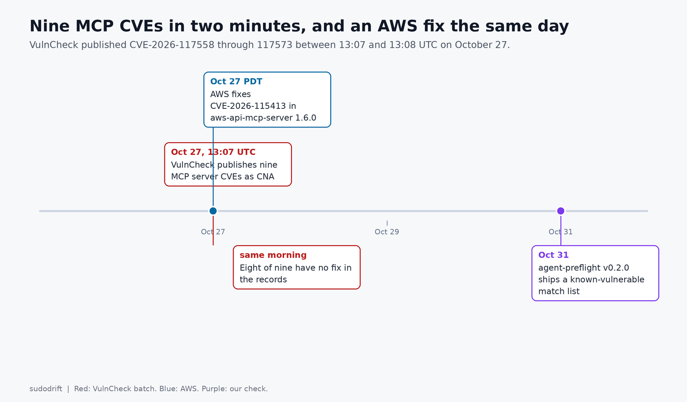
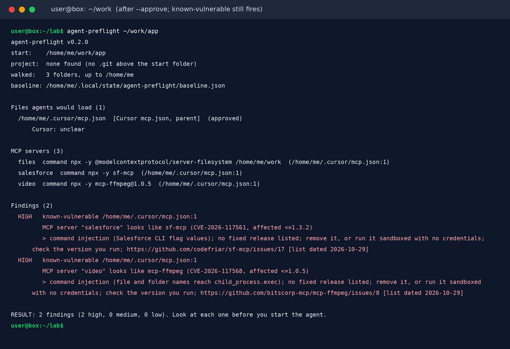
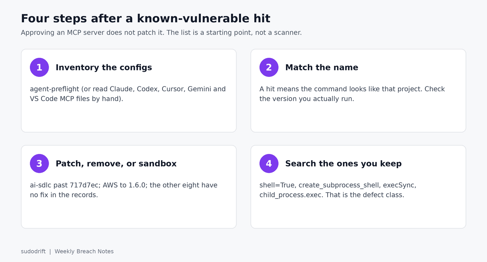

*By sudodrift*

Between 1:07 and 1:08 p.m. UTC on Tuesday, October 27, VulnCheck, acting as CNA, published nine CVE records covering nine Model Context Protocol servers, as [Severity Daily reported](https://severitydaily.com/nine-mcp-servers-command-injection-cve-2026-117558-117573-vulncheck-av-l-pr-l-eight-no-fix/). Eight are OS command injection. The ninth is a permissive allowlist. Every one of the eight injection records is scored `AV:L/PR:L`: a local attack by a low-privileged caller.

That scoring is technically correct and practically useless. In an MCP deployment the local, authenticated caller is the agent. The attacker never logs into the machine. They write text the agent reads, and the agent passes it into a tool parameter that ends up in a shell.



## The nine, and what each one does

I am not going to reprint the full CVE text. Here is the short version, from the records themselves:

| CVE | Server | Affected | Fix |
| --- | --- | --- | --- |
| [CVE-2026-117558](https://www.cve.org/CVERecord?id=CVE-2026-117558) | ai-sdlc plugin MCP server | <=0.31.2 | commit `717d7ec` |
| [CVE-2026-117559](https://www.cve.org/CVERecord?id=CVE-2026-117559) | DroidMind | <=0.4.0 | none listed |
| [CVE-2026-117560](https://www.cve.org/CVERecord?id=CVE-2026-117560) | ATXP Gemini CLI extension | <=1.0.0 | none listed |
| [CVE-2026-117561](https://www.cve.org/CVERecord?id=CVE-2026-117561) | sf-mcp | <=1.3.2 | none listed |
| [CVE-2026-117567](https://www.cve.org/CVERecord?id=CVE-2026-117567) | esp-mcp | through commit 28afddf | none listed |
| [CVE-2026-117568](https://www.cve.org/CVERecord?id=CVE-2026-117568) | mcp-ffmpeg | <=1.0.5 | none listed |
| [CVE-2026-117569](https://www.cve.org/CVERecord?id=CVE-2026-117569) | Kali-GPT | through commit a608c74 | none listed |
| [CVE-2026-117570](https://www.cve.org/CVERecord?id=CVE-2026-117570) | nmap-mcp | through commit 3636afa | none listed |
| [CVE-2026-117573](https://www.cve.org/CVERecord?id=CVE-2026-117573) | hagent | through commit 761eec6 | none listed |

CVE-2026-117560 is the one that names the delivery path: "Attackers can plant instructions in email or SMS content to inject $() or backtick substitutions into parameters like message_id, subject, or query, running commands as the user." CVE-2026-117568 does not even need prompt injection. The payload can live in a file or directory name, so a tool pointed at the wrong folder executes it.

I checked the upstream GitHub issues again on October 31. The ai-sdlc issue was closed on October 23 by the commit the record cites, which runs `gh` without a shell. The issues for the other eight were all still open, with no new commits since the CVEs went out.

Same day, AWS [fixed](https://aws.amazon.com/security/security-bulletins/2026-152-aws/) a different MCP bug, CVE-2026-115413, in `awslabs.aws-api-mcp-server` versions >=1.3.0 and <1.6.0. That one is an OAuth audience check that was never done. A token the identity provider issued to another app in the same tenant was accepted. Only servers using the streamable-http transport with OAuth are affected. Fixed in 1.6.0; set `AUTH_AUDIENCE` (or `AUTH_CLIENT_ID` for identity providers like Amazon Cognito whose tokens carry no audience). If you cannot upgrade yet, AWS says to use the default stdio transport.

Severity Daily's sourcing note is worth repeating: VulnCheck is both the researcher and the CNA for all nine, there is no independent confirmation, and no public PoC beyond the source links. Treat that as a reason to check your configs, not a reason to ignore them.

## The defect is the same every time

Some of these projects tried to stop it. DroidMind has a shell command allowlist. sf-mcp has an `escapeValue()` helper. Both were defeated by `$()` or backticks. nmap-mcp has an allowlist too, for nmap script categories, and it let the blocked `exploit`, `dos`, `brute` and `intrusive` categories through. Filtering a string that is about to be handed to a shell is a race against shell grammar. The fix for the injection bugs, every time, is to stop building a command string and pass an argument array to a non-shell exec instead.

That is also the search you should run on any MCP server you keep, whether or not it is in this list:

```sh
rg -n 'shell=True|create_subprocess_shell|execSync|child_process\.exec\(' path/to/server
```

A hit is not proof of a flaw. It is the place where a prompt-injection path ends at a shell.

## How to inventory what you actually run

MCP servers are configured per client, in files on individual workstations. They almost never show up in an asset inventory. The client's config is the list.

I already ship [agent-preflight](https://github.com/sudodrift/agent-preflight) for this (it is on the [tools page](/tools/) too). It walks Claude Code, Codex, Cursor, Copilot, Gemini CLI and VS Code configs, lists every MCP server it finds, and remembers what you approved. Since [v0.2.0](https://github.com/sudodrift/agent-preflight/releases/tag/v0.2.0) it also compares those servers against a small, dated list of the nine above plus the AWS one. A match is reported as a `known-vulnerable` finding even if you already approved the server, because approving a server does not patch it.

```sh
go install github.com/sudodrift/agent-preflight/cmd/agent-preflight@latest
agent-preflight ~/src/my-project
```

Matching is by package or repository name in the command, args or URL. A hit means "this looks like that project, check which version you run." It is not proof you are on an affected version. A miss is not proof you are safe. Point `--vuln-list` (or `$AGENT_PREFLIGHT_VULN_LIST`) at your own copy of the JSON when you want to add entries without waiting for a release.



## What to do about the ones you find

For ai-sdlc, upgrade past commit `717d7ec`. For the other eight there is no fix in the records, so the choices are remove, sandbox, or accept the risk on purpose. For the AWS server, upgrade to 1.6.0 and set the audience.

Anything that shells out should run under a dedicated low-privilege account, in a container, with no cloud credentials in its environment. The eight injection records all rate the impact high because the command runs as the MCP server user. That is the one variable a deployment decision can change.

And do not point mcp-ffmpeg at a directory whose file names you do not control.



## Sources

- Severity Daily, [Nine MCP servers take command-injection CVEs in one batch](https://severitydaily.com/nine-mcp-servers-command-injection-cve-2026-117558-117573-vulncheck-av-l-pr-l-eight-no-fix/), October 27, 2026
- CVE records CVE-2026-117558, 117559, 117560, 117561, 117567, 117568, 117569, 117570, 117573 (VulnCheck as CNA), read from the CVE Program on October 31, 2026
- The GitHub issues each record links (for example [ai-sdlc #1970](https://github.com/ai-sdlc-framework/ai-sdlc/issues/1970) and [mcp-ffmpeg #8](https://github.com/bitscorp-mcp/mcp-ffmpeg/issues/8)), checked October 31, 2026
- AWS Security Bulletin [2026-152-AWS](https://aws.amazon.com/security/security-bulletins/2026-152-aws/) and GitHub advisory [GHSA-4prq-p2x5-w9fh](https://github.com/awslabs/mcp/security/advisories/GHSA-4prq-p2x5-w9fh) (CVE-2026-115413), October 27, 2026
- Free tool: [sudodrift/agent-preflight](https://github.com/sudodrift/agent-preflight) (known-vulnerable list dated October 29, 2026)

If this was useful, [Weekly Breach Notes](https://weeklybreachnotes.substack.com) sends one of these with the checks every week. Subscribing is free.
