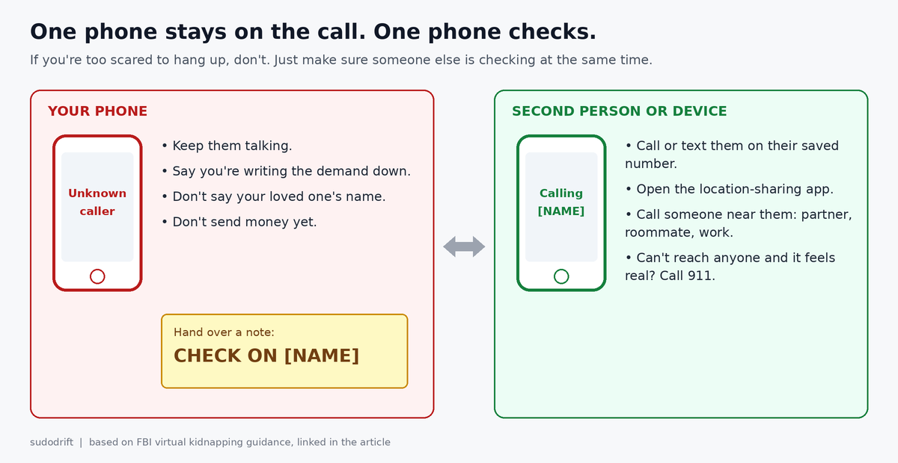
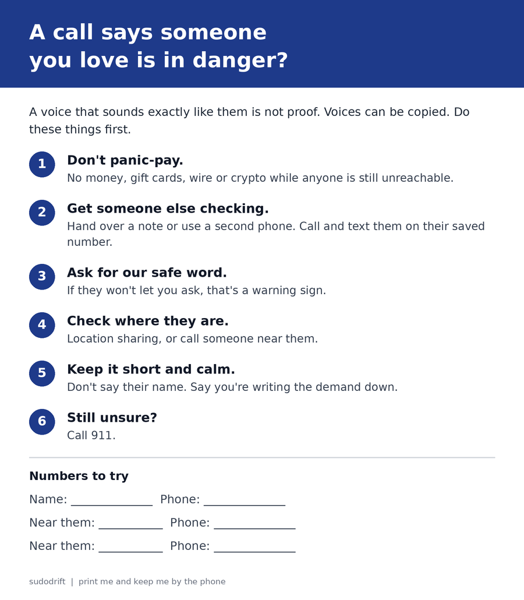

*By sudodrift*

Every article about voice clone scams ends the same way. Pick a family safe word. Hang up and call them back.

That's good advice. I'm going to repeat it below. But one story from this year shows where it breaks, and I think the fix is worth five minutes of your weekend.

## What happened

One morning in May, Deborah Del Mastro picked up a call from a local number in Martinez, California. The man on the line claimed her daughter Sarah, 37, was being held by a Mexican drug cartel. Then he played a voice that sounded exactly like Sarah, crying and struggling to breathe ([ABC7](https://abc7news.com/post/bay-area-mom-thousands-scammers-use-ai-mimic-daughters-voice-fake-kidnapping-part-growing-trend/19154381/)).

She stayed on that call for about five and a half hours. She sent $5,400 in four transfers through MoneyGram and Western Union. She was told Sarah would be let go outside a store. Sarah wasn't there. When Deborah finally called her daughter herself, Sarah picked up. She'd been at work the whole time ([Fox News interview](https://www.foxnews.com/tech/ai-voice-scam-traps-mom-5-hour-kidnapping-nightmare)).

Here's the detail that stuck with me. When the Senate Aging Committee introduced her at a hearing in July, the chair described her as a singer and voice coach who has taught voice for over three decades ([hearing transcript](https://www.govinfo.gov/content/pkg/CHRG-119shrg64451/html/CHRG-119shrg64451.htm)). Listening to voices is her job. It still fooled her.

## What we know and what we don't

Confirmed by her own accounts: the call, the time on the line, the amount, the transfers, and that Sarah was safe. Martinez police are investigating, and she told ABC7 she doesn't expect the money back.

Not confirmed: that the voice was made with AI. Deborah believes it was, and Sarah, who works in IT, suspected a clone right away. No one has published proof. I'm not going to pretend otherwise.

Honestly, it doesn't change the advice. The FBI has warned about "virtual kidnapping" calls for years, long before cheap voice tools. What AI changes is how real the proof sounds. The FBI said in a December 2024 alert that criminals now make short audio clips of a loved one's voice to ask for ransom or emergency money ([FBI IC3 alert](https://www.ic3.gov/PSA/2024/PSA241203)).

## Where the usual advice breaks

The two standard tips assume you get a calm moment. This caller made sure she never had one.

According to her interview with Fox News:

- He told her to charge her phone or bring a charger, because if it died she'd never see her daughter again.
- He wanted the line open the whole time so he could hear who she talked to.
- When she muted the call to talk to her husband, he noticed and started screaming.
- He decided when she could "talk" to Sarah, and told her what to say.
- He gave her a cover story for anyone at the counter who asked about the transfer.

Deborah does recommend a safe word now. But she also said there was no way she could have used one in that situation. The caller controlled every chance to ask.

That's the real problem. "Hang up and call back" is hard when a stranger says hanging up gets your child hurt. The FBI's own list of warning signs starts with this exact move: the caller works hard to keep you on the line, so you never get to check where your loved one really is ([FBI](https://www.fbi.gov/news/stories/virtual-kidnapping)).

## The plan: one phone stays, one phone checks

So I'd stop treating "hang up" as the only option. Plan for the case where you won't.

**Before anything happens (do this today):**

1. Agree on a safe word in person. Something odd that isn't on social media. Not a pet's name. Don't text it to anyone.
2. Agree on the quiet signal. Keep it simple, like a written note that says "CHECK ON [NAME]." Anyone who sees it grabs another phone and starts calling.
3. Turn on location sharing with the people you'd panic about, if you're both comfortable with it. On iPhone, open the Find My app, tap People, tap the Add (+) button, then Share My Location. On Android it's Google Maps, tap your profile picture, then Location sharing, then New share. After this scam, Deborah and Sarah started sharing locations with each other.
4. Save one more number for each person. A partner, roommate or workplace. If your daughter doesn't answer, someone near her can.
5. Tell the older people in your family that a voice on the phone isn't proof anymore. Deborah said she didn't know this was possible.

**If the call comes:**

1. Keep the caller talking if you're scared to hang up. The FBI suggests buying time by repeating the demand and saying you're writing it down.
2. Don't say your loved one's name or share details. The caller in this case opened by asking whether her daughter had panic attacks. That's fishing.
3. Write the note. Hand it to whoever is with you. If you're alone, use a second device, like a tablet or laptop, to text or message them.
4. Ask for the safe word if you get the chance. If they won't let you, that tells you something too.
5. Check the location-sharing app.
6. Don't send money while anyone is still unreachable. If you think it could be real, call 911.

Print the card and put it near the phone at your parents' place. In a panic, nobody remembers a blog post. They might remember a card on the fridge.

## If you already sent money

- Call the transfer company (MoneyGram, Western Union, your bank) right away and ask if they can stop or recall it. Sometimes a pickup hasn't happened yet.
- Report it to local police, and in the US to the FBI at [ic3.gov](https://www.ic3.gov) and the FTC at [reportfraud.ftc.gov](https://reportfraud.ftc.gov). In Canada, report to the [Canadian Anti-Fraud Centre](https://antifraudcentre-centreantifraude.ca/).
- Write down the number that called, the times, and every transfer reference.
- Be kind to the person it happened to. Fox asked Deborah if anyone at the counters stopped her. Nobody did.

## My honest take

I don't think "learn to spot the fake voice" is a real plan. If a voice coach couldn't hear it, I can't either. The safe word is still worth setting up. But the thing that would have ended this call early wasn't a word. It was one other person picking up a second phone and calling Sarah at work.

That takes no app, no money and no tech skill. It just has to be agreed on before the call, not during it.

---

*Weekly Breach Notes is my free newsletter. Subscribe if you want one short email a week on what leaked and what to do about it.*

**Sources**

- ABC7 News (KGO), "Bay Area mom out thousands after scammers use AI to mimic daughter's voice in fake kidnapping": https://abc7news.com/post/bay-area-mom-thousands-scammers-use-ai-mimic-daughters-voice-fake-kidnapping-part-growing-trend/19154381/
- Fox News / CyberGuy Report, interview with Deborah Del Mastro, Oct 7, 2026: https://www.foxnews.com/tech/ai-voice-scam-traps-mom-5-hour-kidnapping-nightmare
- Fortune, "Scammers used AI to fake a kidnapping," Oct 24, 2026: https://fortune.com/2026/10/24/ai-voice-cloning-scam-fake-kidnapping-safe-word/
- US Senate Special Committee on Aging, "The AI Deception Machine" hearing, July 29, 2026 (transcript): https://www.govinfo.gov/content/pkg/CHRG-119shrg64451/html/CHRG-119shrg64451.htm
- FBI, "Virtual Kidnapping": https://www.fbi.gov/news/stories/virtual-kidnapping
- FBI IC3, "Criminals Use Generative Artificial Intelligence to Facilitate Financial Fraud," I-120324-PSA, Dec 3, 2024: https://www.ic3.gov/PSA/2024/PSA241203

*All images are original drawings by sudodrift. Names on the card are placeholders.*
