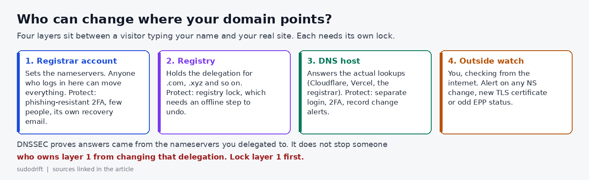

*By sudodrift*

Most teams I talk to have a careful process for production. Named people, MFA, change tickets, logs someone actually reads. Then there's the domain. It was bought years ago on someone's personal card, the login lives in a shared password manager entry, and the recovery email points at a mailbox nobody has opened since the founder left.

That login can send every visitor to any server on the internet. Over the weekend of Oct 30, a group of crypto projects found out what that looks like.

## What happened

Late on Friday, Oct 30, the websites of several DeFi projects started serving a wallet drainer. Security firm Blockaid flagged Flap and Kintsu first, then ten more sites, including Pickle Finance and Origami Finance. The pages ran Step Drainer, a kit that gets visitors to sign wallet approvals that move their funds out ([The Block](https://www.theblock.co/news/defi/2026-10-31-hackers-hijack-a-dozen-defi-websites-all-registered-with-name-com-and-steal-about-138000-432251)).

The common thread was the registrar. Registry records showed all twelve sites Blockaid named were registered through Name.com, even though their DNS was hosted in different places: some on Cloudflare, some on Vercel, some with Name.com itself. Name.com later told The Block that 15 customer domains were affected, that all of them had been restored, and that it had "taken steps to secure the accounts involved" ([The Block](https://www.theblock.co/news/defi/2026-10-31-hackers-hijack-a-dozen-defi-websites-all-registered-with-name-com-and-steal-about-138000-432251), [Crypto Briefing](https://cryptobriefing.com/name-com-restores-hijacked-defi-domains/)). Vercel posted a bulletin saying 10 affected domains were associated with its platform ([Vercel](https://vercel.com/kb/bulletin/name-com-domain-takeover-notice)).

The Block traced about $138,000 to three attacker wallets on EVM chains. That number leaves out anything taken on Solana or Aptos, where some of the affected projects run, so treat it as a floor. The projects that commented said their smart contracts were untouched. The money went out through signatures on a page that looked right, at the right address.

## What nobody knows yet

How the attackers got in. As of Sunday morning, no one has published a root cause. Some projects blamed Vercel. FluxBeam's developer said Name.com's representative was pointing at third parties. Name.com told customers to check their DNS records and turn on two-factor authentication, which tells you what it thinks matters, but not what happened.

So I'm not going to tell you this was a stolen password. It may have been an internal system, a reseller path, or something else. The useful point holds either way: whoever can edit the delegation of your domain controls your users. Your job is to make that set of people and systems as small and as noisy as you can.

## Why I call it a production admin account

Think about what the registrar login can do without touching a single one of your servers:

- change the nameservers, so a different company answers every DNS question about you
- point your login page, your API and your mail at someone else
- let an attacker pass the domain check a certificate authority runs, so their copy of your site gets a real padlock
- in the worst case, start a transfer to another registrar

That's more reach than SSH on any one box. Yet most of us would never let ten people share a root password, and plenty of us share the registrar login without blinking.

## The access review

This is the checklist I'd walk through for every domain that carries logins, payments or a wallet connection. It takes about an hour for a small team.

**1. Find out who really holds the account.** If you bought the domain through a hosting or app platform, the registrar account may belong to that platform, not to you. Ten of these domains sat behind Vercel. Write down the registrar, the account owner, and any reseller in between. If you don't control the account, you can't harden it, and you should decide whether that's acceptable for this domain.

**2. Count the humans.** List everyone who can log in, including old shared logins and sub-accounts. For most small companies the right number is two named people. Not one (you get locked out when they leave) and not everyone in engineering.

**3. Strong second factor, with no SMS fallback.** Turn on 2FA for every person and every account in the chain: registrar, DNS host, reseller. Use a security key or passkey if the provider supports one, because a code from an app can be phished in real time. If only app codes are on offer, use them, store the backup codes offline, and remove SMS as a fallback where you can.

**4. Give the recovery email its own home.** Whoever controls the recovery mailbox can usually reset the account. If that mailbox is `admin@yourdomain.com`, you have a loop: lose the domain, lose the email that would get it back. Use an address on a different domain, protected with the same strong 2FA, and readable by at least two people.

**5. Kill the API keys you don't use.** Registrar APIs are great for automation and terrible as forgotten credentials. List every token. Delete the ones nobody can explain. Scope the rest to the domains they need, if the registrar allows it.

**6. Turn on the registrar's change lock.** A plain transfer lock (`clientTransferProhibited`) stops transfers out. It does nothing against a nameserver change. Look for the lock that also blocks updates. On Name.com that's PrivacyLock, which needs 2FA to turn on and a 2FA code to turn off, and blocks DNS, nameserver and contact changes ([Name.com docs](https://docs.name.com/guides/domain-locks)).

**7. Ask for registry lock on the domains that carry money.** Registrar locks live in the account you're trying to protect. Registry lock is set at the registry itself, using the `serverUpdateProhibited`, `serverDeleteProhibited` and `serverTransferProhibited` statuses ([ICANN EPP status codes](https://www.icann.org/resources/pages/epp-status-codes-2014-06-16-en)). Undoing it needs an out-of-band step between the registrar and the registry, so a stolen login alone isn't enough. Not every registrar or TLD offers it, and it usually costs extra. For a domain that fronts a wallet, I'd pay for it or move the domain to a registrar that offers it.

**8. Turn on DNSSEC, and know what it doesn't do.** DNSSEC lets resolvers check that answers really came from the nameservers you delegated to. That protects you from spoofed answers and some attacks on the DNS host. It does not stop someone who controls your registrar account from changing the nameservers and the DS record together. It's worth having. It isn't a substitute for steps 3, 6 and 7.

**9. Alert on changes from outside.** Don't rely on the registrar to tell you. Check from the internet every few minutes and alert on any difference in:

- the NS records at the parent zone (`dig +short NS example.com @a.gtld-servers.net` for a .com)
- the EPP status codes (an RDAP lookup shows them; a new `clientHold`, or a lock that vanished, is a red flag)
- new certificates for your names in Certificate Transparency logs, especially from a CA you don't use

Free tools already do this well, so I won't write another one. Pick one and make sure the alert lands somewhere a person sees at 11 PM on a Friday.

**10. Write the bad-night runbook now.** Who calls the registrar's abuse line? Who has the account number and the security phrase? Who posts the warning to users? Some of the affected teams limited the damage by moving their nameservers quickly. That only works if someone already knows how, and has the access, before it happens.

## The short version

| Control | What it stops | What it doesn't |
|---|---|---|
| Phishing-resistant 2FA on every account in the chain | Password reuse and phishing | A compromise inside the registrar |
| Recovery email on another domain | Reset loops and hijacked mailboxes | A weak second factor |
| Registrar update lock | Quick nameserver changes from a stolen session | An attacker who can also pass 2FA |
| Registry lock | Changes pushed through the registrar account | Changes inside your own DNS host |
| DNSSEC | Forged DNS answers | A changed delegation |
| Outside monitoring | Silent changes going unnoticed | Anything. It only tells you, fast |

No single row is enough. Together they turn "one login moves everything" into "several people and an offline step move everything, and we hear about it in minutes."

## My honest take

DeFi teams spend a lot on smart contract audits, and that's fine. This weekend the contracts were fine and users still lost money, because the weak part was a web account most of us set up once and forget. You don't need to run DeFi for this to apply. If your domain hosts a login page, it's production. Give its keys the same respect.

---

*Weekly Breach Notes is my free newsletter. Subscribe if you want one short email a week on what leaked and what to do about it.*

**Sources**

- The Block, "Hackers hijack a dozen DeFi websites, all registered with Name.com, and steal about $138,000," Oct 31, 2026, updated 3:37 PM ET: https://www.theblock.co/news/defi/2026-10-31-hackers-hijack-a-dozen-defi-websites-all-registered-with-name-com-and-steal-about-138000-432251
- Crypto Briefing, "Name.com restores hijacked domains after attack hit at least 12 DeFi front ends," Oct 31, 2026: https://cryptobriefing.com/name-com-restores-hijacked-defi-domains/
- Vercel, "Name.com domain takeover notice," Oct 31, 2026: https://vercel.com/kb/bulletin/name-com-domain-takeover-notice
- Name.com Core API docs, "Understanding Domain Locks": https://docs.name.com/guides/domain-locks
- ICANN, "EPP Status Codes: What do they mean, and why should I know?": https://www.icann.org/resources/pages/epp-status-codes-2014-06-16-en

*The image is original by sudodrift.*
