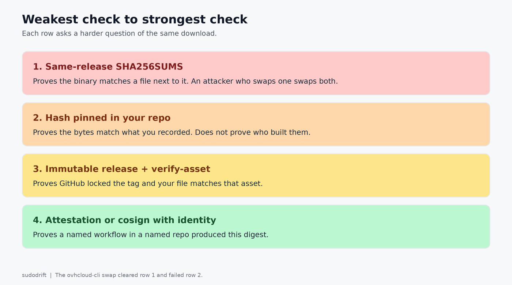
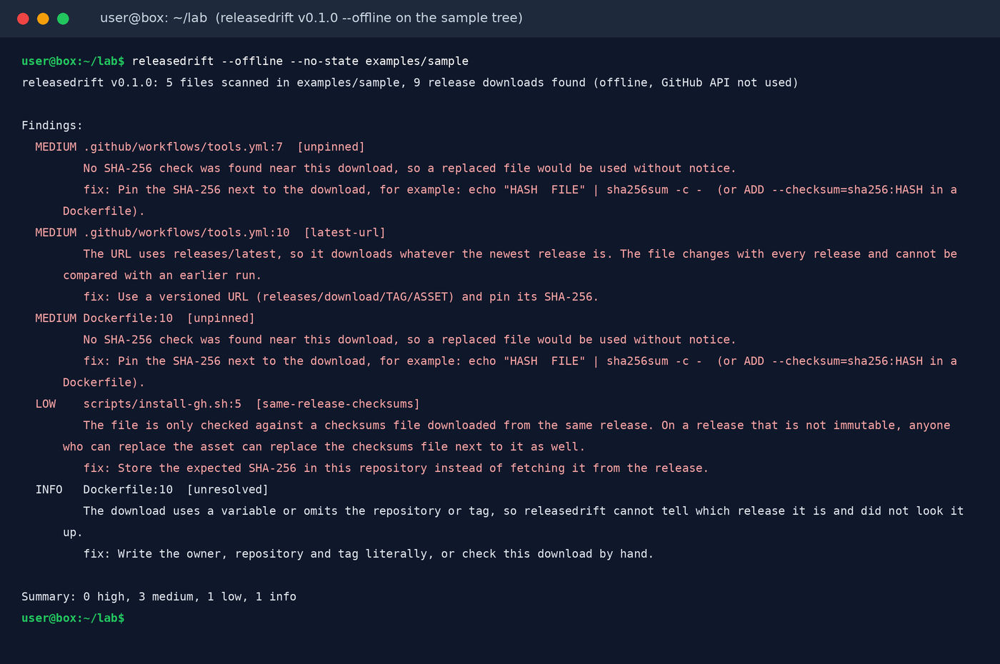
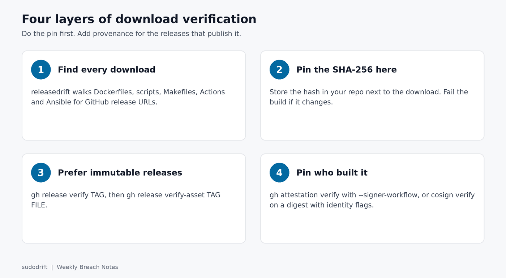

*By sudodrift*

On October 19 a stolen developer account was used to replace the release files of ovhcloud-cli v0.11.0 through v0.15.0. The tags stayed the same. On the newest releases the attacker replaced `checksums.txt` too, last, so the published hashes matched the new files. Anyone who checked the binary against that file saw a clean result and ran a credential stealer.

OVHcloud's advisory says a customer reported the problem through a GitHub issue. StepSecurity's write-up of the swap shows how that customer noticed: their CI pinned the SHA-256 of the Linux arm64 tarball in their own repository, and the build failed. Nobody who trusted the release's own checksums file caught anything. (I covered the incident itself in [an earlier post](/posts/ovhcloud-cli-swap/).)

So "verify the download" has to mean something stronger than "the hash matches a file next to it."



## Three checks that ask who built it

**1. GitHub artifact attestations, with the workflow pinned.**

```sh
gh attestation verify ./tool \
  --repo OWNER/REPO \
  --signer-workflow OWNER/REPO/.github/workflows/release.yml
```

That fetches the signed attestation for this exact digest and checks that it was produced by that workflow in that repository. Use `--signer-workflow` or `--cert-identity` (exact SAN), not both; `gh` rejects the combination. Add `--deny-self-hosted-runners` if you do not want attestations from runners you do not control. `--repo` alone is the floor. Pinning the workflow is the useful part.

**2. Immutable releases, then the local file.**

```sh
gh release verify v1.2.3 -R OWNER/REPO
gh release verify-asset v1.2.3 ./tool -R OWNER/REPO
```

`gh release verify` checks that the release exists and is immutable. `gh release verify-asset` checks that your file on disk is an exact match for the attested asset of that tag. It cannot verify the auto-generated source zip or tarball, because those are built at download time.

OVHcloud's clean v0.16.0 is an immutable release, so the fixed CLI is a real example: `gh release verify-asset v0.16.0 ovhcloud-cli_Linux_x86_64.tar.gz -R ovh/ovhcloud-cli`.

**3. Cosign on a container digest, with identity constraints.**

```sh
cosign verify ghcr.io/OWNER/REPO@sha256:DIGEST \
  --certificate-identity=https://github.com/OWNER/REPO/.github/workflows/release.yml@refs/tags/v1.2.3 \
  --certificate-oidc-issuer=https://token.actions.githubusercontent.com
```

Verify the digest, never a floating tag. Since Cosign 2.0, keyless verification refuses to run without an identity and an issuer, which is good. The trap now is a regex so loose it matches anyone, such as `--certificate-identity-regexp '.*'`. That only proves *someone* in the Sigstore ecosystem signed it. Pin the digest in the Dockerfile or the deploy script so a later run fails if the image moves.

## What still proves almost nothing

- A `SHA256SUMS` or `checksums.txt` downloaded from the same release or the same server as the binary. The ovhcloud-cli swap replaced both.
- Fetching the GPG key from the same site as the package.
- `cosign verify` with an identity regex of `.*`.
- `curl | sh`. The ovhcloud-cli install script did no checksum check at all.

Store the expected SHA-256 in your own repository, next to the download instruction. Then the release can be swapped and your CI still fails.

## Where releasedrift fits

Most teams never get as far as attestations because the download is not pinned at all. [releasedrift](https://github.com/sudodrift/releasedrift) walks a source tree, finds every GitHub release download in Dockerfiles, shell scripts, Makefiles, Actions workflows and Ansible playbooks, and tells you which ones have no SHA-256 nearby and which ones only check against a checksums file from the same release. Without `--offline` it also asks the GitHub API for the digest GitHub reports for each asset and keeps it in a state file, so a later run notices when a file was replaced, and it warns when a release is not immutable. It only reads, and works without a token.

```sh
go install github.com/sudodrift/releasedrift/cmd/releasedrift@latest
releasedrift --offline /path/to/your/repo
```

Here it is on the sample tree that ships in the repository:



The finding that matches the ovhcloud-cli failure mode is tagged `same-release-checksums`. The fix line is the whole point of this post: store the expected SHA-256 in this repository instead of fetching it from the release.

Once every download is pinned, add the attestation or cosign check for the ones that publish one. Pinning without provenance still beats a checksums file that travels with the binary. Provenance without a pin still lets a later tag move under you.



## Sources

- GitHub Docs, [Verifying the integrity of a release](https://docs.github.com/en/code-security/how-tos/secure-your-supply-chain/secure-your-dependencies/verify-release-integrity) (`gh release verify`, `gh release verify-asset`)
- GitHub CLI manual, [`gh attestation verify`](https://cli.github.com/manual/gh_attestation_verify) (use `--signer-workflow` or `--cert-identity`, not both)
- Sigstore, [Verifying signatures with Cosign](https://docs.sigstore.dev/cosign/verifying/verify/) and [Cosign 2.0 released](https://blog.sigstore.dev/cosign-2-0-released/) (identity flags required)
- OVHcloud CLI advisory [GHSA-862f-55f5-vmvw](https://github.com/ovh/ovhcloud-cli/security/advisories/GHSA-862f-55f5-vmvw), the reporter's [issue #300](https://github.com/ovh/ovhcloud-cli/issues/300), and StepSecurity's [write-up of the swap](https://www.stepsecurity.io/blog/ovhcloud-cli-github-release-swap-glassworm)
- Free tool: [sudodrift/releasedrift](https://github.com/sudodrift/releasedrift) ([v0.1.0](https://github.com/sudodrift/releasedrift/releases/tag/v0.1.0))
