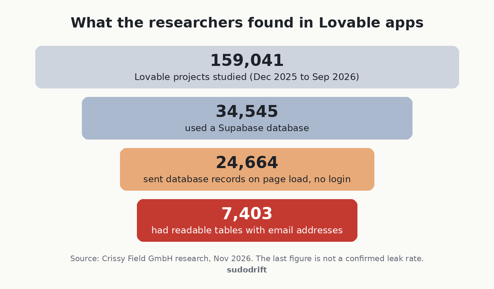
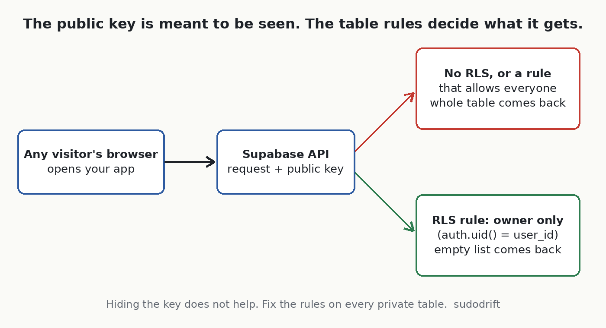
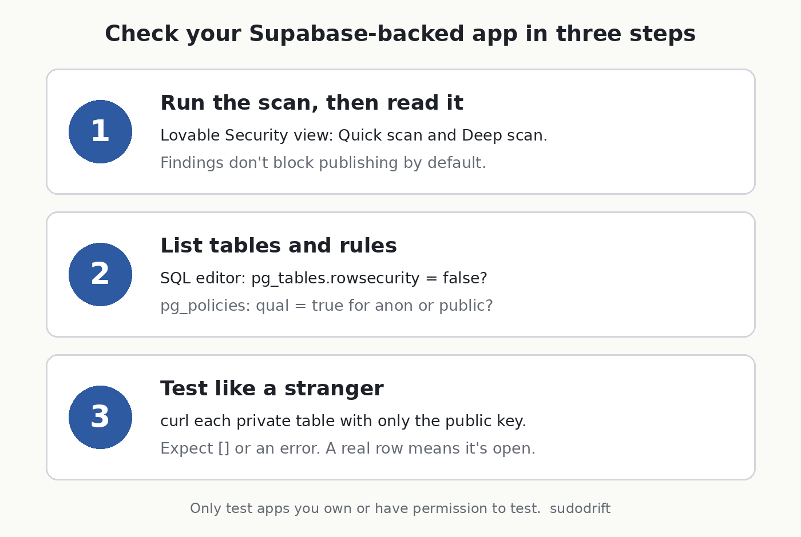

A security firm in Hamburg looked at apps people built with Lovable, the AI tool that turns a chat prompt into a working web app. In thousands of them, anyone who opened the site could read the database behind it. No password, no hacking tool. Just the same key the page already hands to every visitor.

I've done enough access reviews to know this one isn't really about AI. It's about a database rule nobody checked. But AI made it very easy to ship an app with real users before anyone asked who can read what.

If you built something with Lovable, or any app that talks to Supabase straight from the browser, this post shows you how to check it from the outside in about ten minutes.

## What happened

Crissy Field GmbH, an application security firm, did the research with the German business paper Handelsblatt, which published its story on November 2, 2026. Crissy Field put its own write-up online in English, and Cybernews and others picked it up on November 4 ([Crissy Field](https://www.crissyfield.de/research/lovable-en/), [Cybernews](https://cybernews.com/security/lovable-ai-apps-expose-personal-information/)).

Here are their numbers, as they report them:



They found the projects in Common Crawl, a public archive of the web, covering December 2025 to September 2026. 24,664 sites sent database records as soon as the page loaded. That part can be fine, since some data is meant to be public. The problem came when they made a few more read-only requests with the same key. On 7,403 of those sites they could read tables holding email addresses.

The examples they give are the bad part. A German lifestyle forum with more than 80,000 profiles and over 200,000 chat messages. Event organizers and restaurants with ticket and food orders, including phone numbers, home addresses, payment information and ticket codes. A service provider with more than 1,000 passport records. And one I keep thinking about: a property management company that stored AI-written summaries of its internal emails about tenants and owners, readable by anyone.

## What's confirmed and what isn't

Confirmed, by the researchers: the data was reachable without logging in, and they only used read-only requests.

Not confirmed: whether anyone else found this data first and used it. Crissy Field says plainly it could not tell. It also warns that the 30% figure is not a leak rate. Some of those email addresses could be public contact addresses or test data, and their sample is not every Lovable app.

Not public: which apps were affected. The researchers have not named them, and they kept their exact method to themselves. Good. I won't guess at it either.

Lovable's side: according to the coverage, Lovable said this is a known problem across the industry with how people set up Supabase, not a hack of Lovable. That's partly fair. UpGuard separately reported readable tables on 16,326 Supabase databases, per Cybernews. But "it's everyone's problem" doesn't help the person whose passport number is sitting in a table.

## Why the key in your page isn't the problem

This trips people up, so here's how it works.

A Supabase app running in the browser carries a public key, often called the anon key or publishable key. It is supposed to be visible. Anyone can open developer tools and see it.

What protects your data is Row Level Security, or RLS. It's a set of rules inside the database that says which rows each visitor may read or change. With RLS on and good rules, the public key gets a stranger almost nothing. With RLS off, or with a rule that says "allow everyone", that same key reads the whole table.



So the fix is never "hide the key". The fix is the rules.

## How to check your own app

You need to own the app or have permission to test it. Only test your own project.



### 1. Run Lovable's own scan, and read it

Lovable's docs say a Quick scan runs when you open the Publish dialog and checks for things like tables without RLS and access rules that let everyone through. There's also a Deep scan you start yourself from the project's Security view, and your policies are under More, then Database, then Manage, then Policies ([Lovable docs](https://docs.lovable.dev/features/security)).

One detail matters. The same docs say findings do not block publishing by default. So a scan that warned you and got clicked past is exactly how a table ends up open. If you're a workspace admin, Lovable has a setting to block publishing on critical findings ([Lovable publish docs](https://docs.lovable.dev/features/publish)). I'd turn it on.

### 2. Look at the rules yourself

Open the SQL editor in your Supabase dashboard and run this. It's read-only.

```sql
-- Which tables in the public schema have RLS switched off?
select tablename, rowsecurity
from pg_tables
where schemaname = 'public'
order by rowsecurity, tablename;

-- What rules exist, and what do they allow?
select tablename, policyname, cmd, roles, qual
from pg_policies
where schemaname = 'public'
order by tablename;
```

In the first result, any table with `rowsecurity` set to `false` is readable through the public key, as long as that table is exposed through the API. In the second, look for rules where `qual` is just `true` and `roles` includes `anon` or `public`. That means "anyone can read every row". It's fine for a menu or a blog post. It's not fine for orders, profiles, messages or anything with an email in it.

Supabase's dashboard also has a Security Advisor that flags tables with RLS off. Worth a look, but read the rules yourself too.

### 3. Test from outside, the way a stranger would

This is the step most checklists skip, and it's the one that tells you the truth. Open your live site in a private window, open developer tools, and look in the Network tab for requests to `supabase.co`. You'll see your project address and the public key in the request headers.

Then, from a terminal, ask for one row of each table that holds anything private:

```bash
PROJECT="https://YOUR-PROJECT.supabase.co"
KEY="the public key your page sends"

for t in profiles orders messages bookings; do
  echo "== $t"
  curl -s "$PROJECT/rest/v1/$t?select=*&limit=1" \
    -H "apikey: $KEY" \
    -H "Authorization: Bearer $KEY"
  echo
done
```

Change the table names to yours. If your key is one of the newer `sb_publishable_` keys and the request complains about the Authorization header, drop that line and keep `apikey`.

What you want back for private tables is an empty list `[]` or a permission error. If you get a real row with a real person's data, that table is open to the world right now.

### 4. If something is open

Turn RLS on for that table and write a rule that limits rows to their owner. For a table with a `user_id` column, the common pattern looks like this:

```sql
alter table public.orders enable row level security;

create policy "owners read their own orders"
on public.orders for select
to authenticated
using ( (select auth.uid()) = user_id );
```

Test the app afterwards, because turning RLS on with no rules blocks everyone, including your own users. Then run the curl test again and make sure you get nothing back.

If personal data was readable, treat it as possibly seen. You can't prove it wasn't. Depending on where you and your users are, that may mean you have to notify people or a regulator. In Canada that's PIPEDA's breach rules, in Europe it's GDPR. I'm not a lawyer, so if you're unsure, ask one.

One more habit: don't store what you don't need. Nobody can leak a passport number you never collected.

## If you're a user of a small app

Honestly, you can't check this from your side, and the researchers didn't name the apps. What you can do is expect the follow-up. Exposed order and ticket records are perfect material for scam emails and texts that quote a real booking or a real ticket code. If a message knows your recent order and asks you to "confirm payment" or "reissue your ticket", go to the site yourself instead of clicking.

## My take

I don't think the lesson is "don't build with AI". People have shipped open databases by hand for years. The difference is speed. An app can go from idea to taking payments in an afternoon, and the one thing the tool can't know is which of your tables is private. You have to tell it, and then you have to check.

If you only do one thing from this post, do the curl test. It takes five minutes and it shows you what a stranger sees.

## Sources

- Crissy Field GmbH, "Lovable: Many Apps Expose Sensitive Data": https://www.crissyfield.de/research/lovable-en/
- Cybernews, "Apps built on Lovable AI expose passport details and 200,000 chat messages" (Nov 4, 2026): https://cybernews.com/security/lovable-ai-apps-expose-personal-information/
- Lovable docs, Security overview: https://docs.lovable.dev/features/security
- Lovable docs, Publish your Lovable project: https://docs.lovable.dev/features/publish
- Lovable docs, Security best practices: https://docs.lovable.dev/tips-tricks/security-best-practices

If you want one short, practical security note like this each week, subscribe to [Weekly Breach Notes](https://weeklybreachnotes.substack.com).
