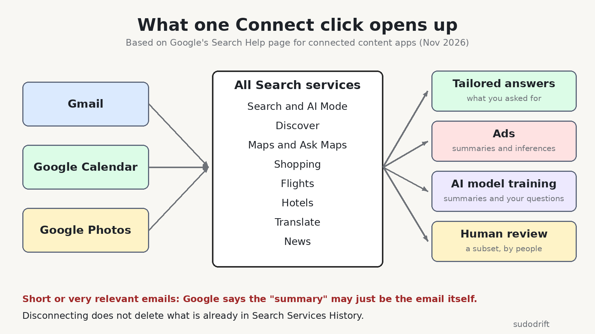
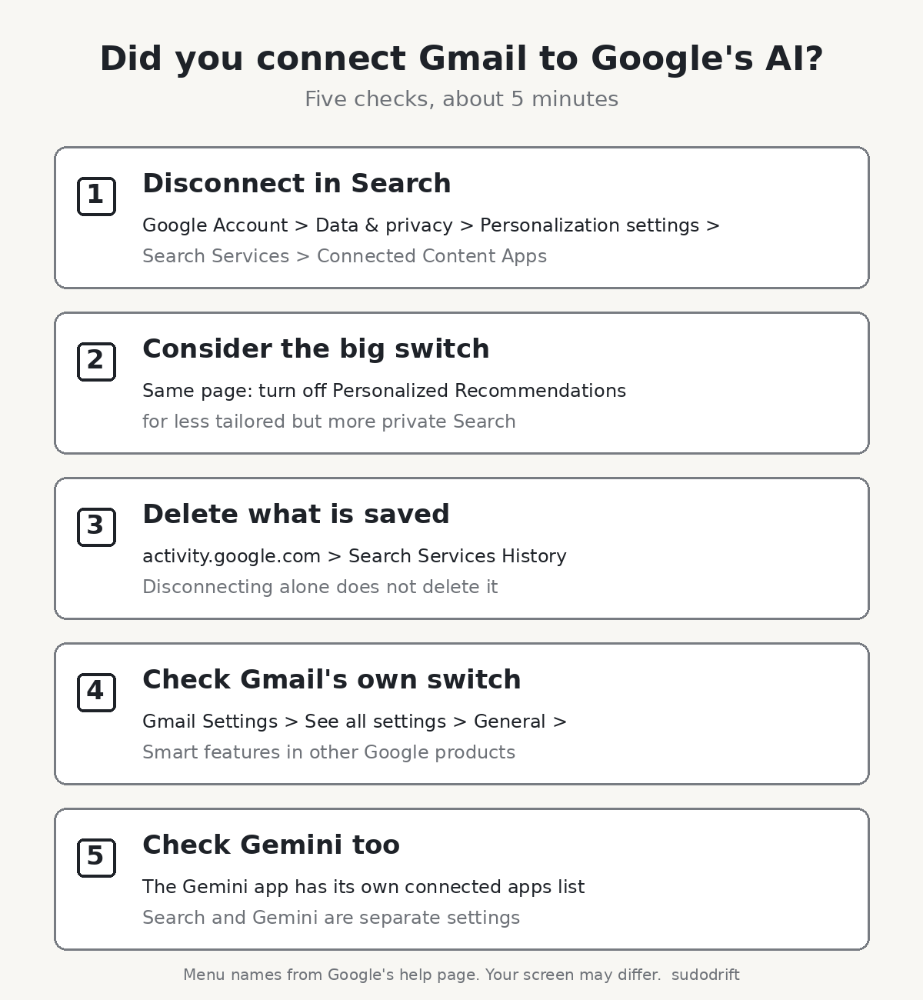

*By sudodrift*

On October 16, 2026, Google changed one sentence in its privacy policy. It used to say Google does not show you personalized ads based on your content from Drive, Gmail or Photos. Now that sentence ends with an exception: "unless you choose to make data from these services available to other Google services that support personalized ads" ([Google Privacy Policy](https://policies.google.com/privacy)).

Most of the coverage stopped at the ads part. That is fair, it is the news. But I went and read Google's own help page for the feature behind it, and the ads are the smallest part of what you agree to when you click Connect.

This post is about what that switch actually lets Google's AI see, where it goes after that, and how to check your own account in a few minutes.

## What changed, in plain words

Google has a feature called Personal Intelligence. In Search, it lets AI Mode and Ask Maps use your past searches, and, if you connect them, your Gmail, Google Calendar and Google Photos, to give answers that fit you. Google's example is using an old restaurant booking in your email to suggest new places to eat ([Google Search Help](https://support.google.com/websearch/answer/16859283?co=GENIE.Platform%3DDesktop&hl=en)).

The October policy change says that if you make that data available to a Google service that shows personalized ads, it can shape those ads too. The Verge and Ars Technica both reported this after Android Authority spotted it ([The Verge](https://www.theverge.com/tech/1017600/google-personal-intelligence-privacy-policy-ads-update), [Ars Technica](https://arstechnica.com/gadgets/2026/10/updated-google-privacy-policy-says-your-gmail-might-be-used-for-advertising/)).

Google told Ars that connecting is fully optional, and that ads won't be built straight from your inbox or photo library.

So if you never clicked Connect, this does not apply to you. If you did, or you are not sure, keep reading.

## What the connection reaches

This is the part I did not expect. Google's help page says that connecting your apps means all Search services are allowed to access them, not only AI Mode. It lists those services as Google Search (including AI Mode and Discover), Maps (including Ask Maps), Shopping, Flights, Hotels, Translate and News.

Right now the Workspace side means Gmail and Google Calendar, and Google says more Workspace apps will follow. Calendar is only offered in the US in English. Photos is not offered everywhere.

Canada, the US, India and Australia are all on the list of places where this is available. Google's help page says it is for users 18 and over with a personal Google account.

## What happens to what it reads

Here is what Google's help page says, in my own words.

It uses summaries, not your whole inbox. Mostly. Google says Search works from summaries, short excerpts and guesses it draws from the emails and photos that matter to your question. But the same page also says that when an email or file is short, or very relevant, the summary "may just be the email or file." So for a short booking email or a one line message, the summary can be the message itself.

It can train Google's AI models. If you connect, Google says it may use that data to improve its services for all users, and that includes training its generative AI models on those summaries and excerpts. It also trains on your questions and its answers. Google says it takes steps to reduce personal information before training.

People may read some of it. Google says a subset of the data that AI Mode and Ask Maps process is reviewed by human reviewers, including outside service providers. That subset can include summaries and excerpts from your emails, and again, sometimes the summary is the email. Google says it disconnects these from your account and reduces personal details first. For Photos, it says humans do not view your actual media except for abuse cases or when you send feedback.

Google's own advice on that page is blunt. Do not connect your apps if they hold personal or confidential information you would not want a reviewer to see. I think that sentence should be on the Connect button, not halfway down a help page.

It feeds ads. Google says the same summaries and excerpts Search uses to answer you can also pick the ads you see. Advertisers do not get your inbox or photos, and Google says it does not target ads on sensitive categories like race, religion, sexual orientation or health.

Disconnecting does not clean up. Google says that disconnecting an app, or deleting the email or photo, does not delete anything already saved in your Search Services History. Google can keep using that saved copy to improve its products, AI training included. You have to delete the history yourself.

## What we do not know

I want to be honest about the gaps.

Google does not say how big the "subset" sent to human reviewers is. It does not say how long reviewed data is kept. It does not explain what an "inference" looks like in practice, for example whether "this person is planning a trip to Lisbon" counts.

I also could not click through these settings on a real account for this post. The menu names below come from Google's help page and from Android Authority's walkthrough. Google also says the Search services settings are being updated right now, so your screen may look a bit different.

## Who this affects

- Anyone who tried AI Mode or Ask Maps and clicked Connect when it asked to use Gmail or Photos.
- Families that share one Google account on a tablet or laptop. One person connecting it connects it for everyone's mail on that account.
- People whose inbox holds medical, legal, money or work email they would never paste into a chatbot.

## How to check your account in about 5 minutes

1. See what Search is connected to. Go to your Google Account, then Data & privacy, then Personalization settings, then Manage Personalized Recommendations in Search Services. Under Additional Personal Intelligence, open Connected Content Apps. If Google Workspace or Google Photos says Connected, click it to disconnect. Android Authority says you will see a warning that data already collected can still be used.

2. Decide on the bigger switch. On that same Search Services page you can turn off Personalized Recommendations entirely. That is the stronger option. You will get less tailored results.

3. Delete what is already saved. Disconnecting is not deleting. Go to [activity.google.com](https://activity.google.com), find your Search Services History, and delete it, or set auto delete to the shortest period you are comfortable with.

4. Check Gmail's own switch. In Gmail on a computer, open Settings, then See all settings. On the General tab, find Google Workspace smart features and select Manage Workspace smart feature settings. Google's help page says "Smart features in other Google products" needs to be on for Search to personalize from Gmail. Turning it off is a second lock. Be aware it can turn off other helpful features too, so read what it lists before you save.

5. Check Gemini separately. The Gemini app has its own Personal Intelligence and connected apps settings. Android Authority says disconnecting in Search does not stop the Gemini app from reading Gmail or Photos if you allowed it there. Open Gemini's settings and look at its connected apps list too.

If you use a work or school Google account, your admin controls most of this, and Google says the feature needs a personal account.

## My take

I do not think connecting is always wrong. Asking Maps for directions to the hotel in your booking email is useful. But the trade is bigger than "better answers, maybe some ads." It is answers, ads, AI training and a chance that a person reads a short email of yours. If your inbox is the place where your whole life lives, I would leave it disconnected and paste in the one booking email when you need it.

Want one short email a week on breaches and what to do about them? Subscribe to Weekly Breach Notes.

## Sources

- Google Privacy Policy, effective October 16, 2026: https://policies.google.com/privacy
- Google Search Help, "Connect your Google content apps to get a Search services experience that's tailored to you": https://support.google.com/websearch/answer/16859283?co=GENIE.Platform%3DDesktop&hl=en
- The Verge, "Now Google says it might use your Gmail and Google Photos data to target ads," Oct 23, 2026: https://www.theverge.com/tech/1017600/google-personal-intelligence-privacy-policy-ads-update
- Ars Technica, "Updated Google privacy policy says your Gmail might be used for advertising," Oct 2026: https://arstechnica.com/gadgets/2026/10/updated-google-privacy-policy-says-your-gmail-might-be-used-for-advertising/
- Android Authority, "How to stop Google from using your Gmail or Photos info for ads": https://www.androidauthority.com/google-personal-intelligence-ads-opt-out-3729942/
