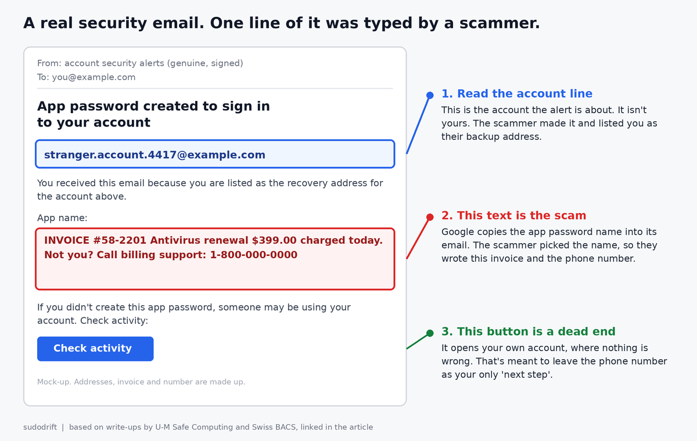
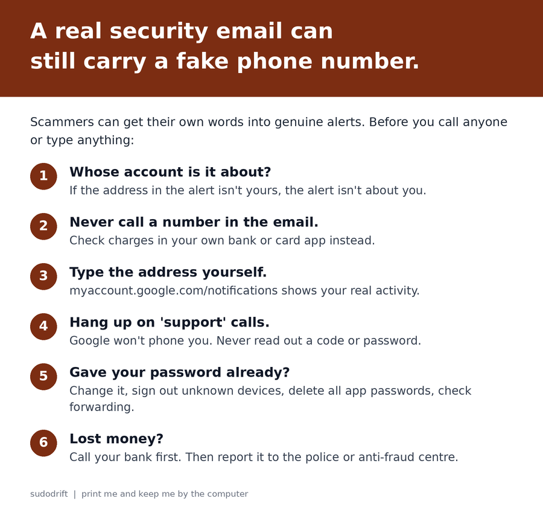

*By sudodrift*

Most phishing advice comes down to one check. Look at who really sent the email.

This scam passes that check. The email really does come from Google. It's signed by Google, it lands in the same thread as your other Google alerts, and the buttons in it go to real Google pages. The only fake part is a single line of text in the middle. A scammer typed it.

I think this one is worth ten minutes, mostly because the usual tips make it more convincing, not less.

## What happened

Two security teams wrote up the same trick from different sides.

In September, Switzerland's federal cybersecurity office (BACS, the former NCSC) described a case that started with a genuine Google security warning ([NCSC Switzerland, Week 38](https://www.bacs.admin.ch/en/26w38-en)). The scammers had made their own new Google account and put the victim's email address in as that account's recovery address. Then they created an app password in their own account. An app password is an old style passcode for apps that can't do a normal Google sign-in, and Google lets you give it any name you like.

They named it something like "Kevin W. Case ID: 834333 To view your case". Google sent its normal alert about the new app password to the recovery address, which was the victim. Google's email repeated the name. So the victim saw what looked like Google opening a support case, with a case handler and a case number.

A phone call followed from someone claiming to be Google security support, showing a Swiss number. The caller pushed the victim to a login page built on Google Sites, so the web address still said google. The form sent the password to the scammers.

On October 6, the University of Michigan's IT security team posted a second version ([U-M Safe Computing](https://safecomputing.umich.edu/phishing-alerts/app-password-created-sign-your-account-tue-10062026-1200)). This time the app password was named after a fake McAfee invoice for $399 with a support phone number. The genuine Google alert was then forwarded on to people at the university, and because it carried valid signatures it passed all of their mail checks.

## The clever part

U-M points out something I hadn't thought about. If you do the careful thing and click the real "check activity" button, you land on your own Google account. Nothing is wrong there, because the app password was made on someone else's account.

That's on purpose. You're worried, you checked, and you found nothing. The only thing left in the email that looks like it might explain the charge is the phone number.

## What's confirmed and what isn't

Confirmed by the two official write-ups:

- The alert emails are genuine Google messages. The scam text rides inside the app password name.
- One version pushes you to call about a fake invoice. The other is followed by a call from fake Google support.
- In the Swiss case, after getting the password, the scammers set up their own app password inside the victim's real account within minutes. BACS says that let them keep access even after the victim changed the password, and email and contacts kept syncing to a device abroad for some time.

Not known: how many people got these emails, how many called, or how much money was lost. Neither source gives numbers, so I won't guess.

One honest wrinkle. Google's own help page says it revokes your app passwords when you change your Google password ([Google Account Help](https://support.google.com/accounts/answer/185833?hl=en)). The Swiss report says the scammers kept access after a change anyway. I can't tell from the outside why those two don't match, maybe the timing or how the change was done. So I'd do both: change the password and also delete app passwords by hand. It costs you thirty seconds.

## How to read one of these emails

1. **Read the account line first.** A Google alert names the account it's about. If that address isn't your account, the alert isn't about you. It's about the scammer's account, with you listed as their backup.
2. **Treat any invoice, case number or phone number as the scammer's words.** In this trick, that's the only part they control.
3. **Never call a number from an email about a charge.** If you think you were billed, open your bank or card app yourself and look.
4. **Check your account by typing the address.** Google's advice is to go to myaccount.google.com/notifications yourself to see recent security activity ([Gmail Help](https://support.google.com/mail/answer/8253?hl=en)). If nothing is there, good. That matches this scam.
5. **Google won't phone you about this.** BACS's advice is to hang up on any unexpected call about a security incident. Never read out a code or type a password while someone on the phone is telling you to.
6. **Real Google sign-in pages are on accounts.google.com.** Not sites.google.com, even though that one also says google.

## If you think you already gave out your password

Do this from a device you trust, not one the caller asked you to install anything on.

1. Change your Google password at myaccount.google.com, then Security.
2. On the same Security page, open "Your devices" and sign out anything you don't know.
3. Go to myaccount.google.com/apppasswords. Delete every entry. BACS says all of them, without exception. If you have an old printer or mail app that needs one, make a fresh one later.
4. In Security, check your recovery email and recovery phone. Remove anything that isn't yours.
5. In Gmail on a computer, open Settings, See all settings, then Forwarding and POP/IMAP, and Filters and Blocked Addresses. Delete any forwarding or filter you didn't set up.
6. If you paid or let anyone onto your computer, call your bank now, then report it. In Canada that's the [Canadian Anti-Fraud Centre](https://antifraudcentre-centreantifraude.ca/). In the US, the FTC at [reportfraud.ftc.gov](https://reportfraud.ftc.gov).

## What I didn't test

I haven't recreated this. I didn't make an app password with a scam name to see what Google sends, because I'm not going to try a scammer's recipe on Google's mail system. Everything above about the email itself comes from the two security teams' write-ups. The steps for cleaning up your own account use Google's own help pages.

## My honest take

For years we told people to check the sender. That's still good advice. But this scam shows the sender check isn't enough on its own anymore, because the sender is real.

The better habit is simpler. A security email can tell you something happened. It should never be the place you get a phone number from. If a number is in there, someone put it there for you to call, and that someone isn't Google.

If your parents use Gmail, this is the one I'd mention at dinner. Older relatives are exactly the people who've learned "check it's really from Google" and will feel safe when it is.

---

*Weekly Breach Notes is my free newsletter. Subscribe if you want one short email a week on what leaked and what to do about it.*

**Sources**

- NCSC Switzerland (BACS), "Week 38: Genuine Google emails, fake support and a dangerous back door," Sep 22, 2026: https://www.bacs.admin.ch/en/26w38-en
- University of Michigan Safe Computing, "App password created to sign in to your account," Oct 6, 2026: https://safecomputing.umich.edu/phishing-alerts/app-password-created-sign-your-account-tue-10062026-1200
- Google Account Help, "Sign in with app passwords": https://support.google.com/accounts/answer/185833?hl=en
- Gmail Help, "Avoid and report phishing emails": https://support.google.com/mail/answer/8253?hl=en
- Canadian Anti-Fraud Centre: https://antifraudcentre-centreantifraude.ca/
- FTC, ReportFraud: https://reportfraud.ftc.gov

*All images are original drawings by sudodrift. The email is a mock-up with made-up addresses and a fake number, not a copy of a real message.*
