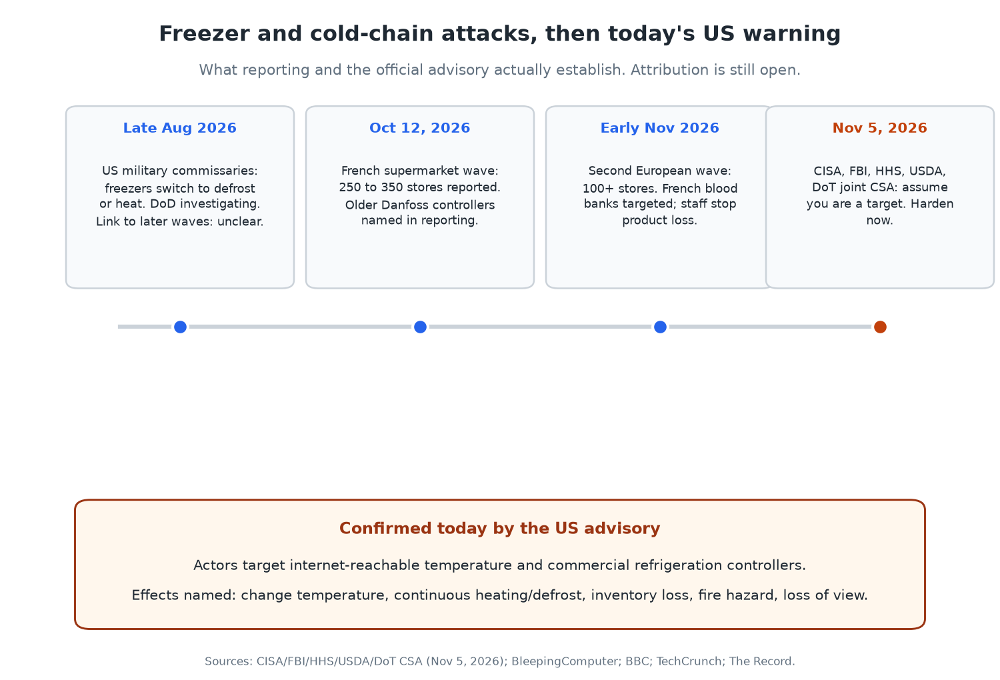
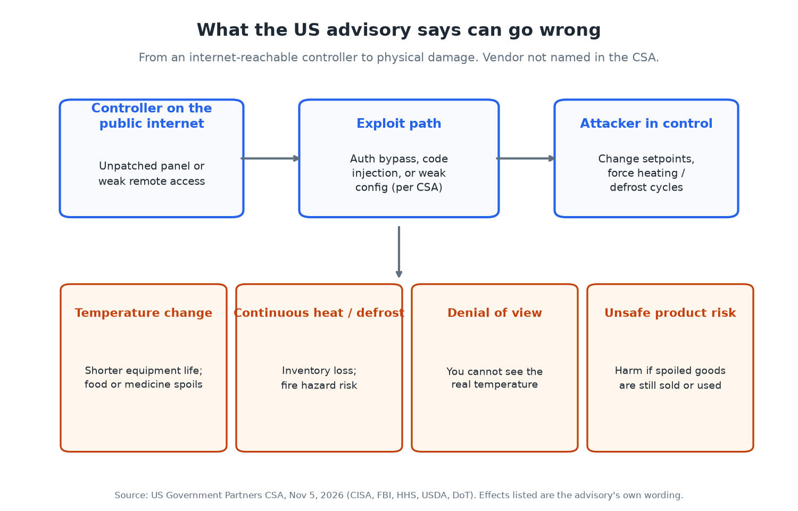
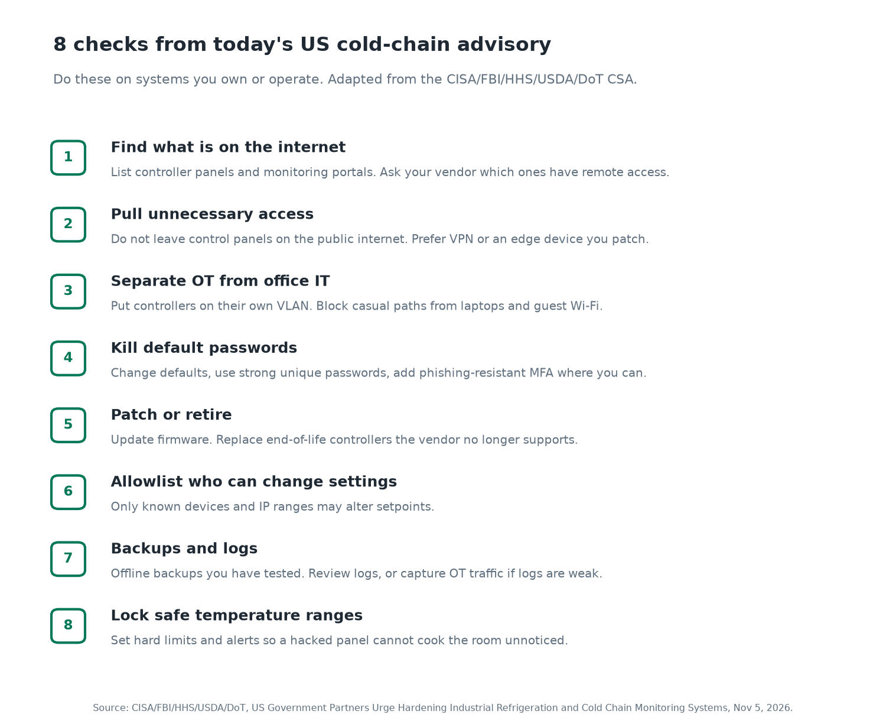

Today the US put it in writing. CISA, the FBI, HHS, USDA and the Department of Transportation published a joint cybersecurity advisory about industrial refrigeration and cold chain monitoring systems. Their line is blunt: every organisation that depends on these systems should assume it could be a target ([CSA PDF](https://www.ic3.gov/CSA/2026/261105.pdf), [TechCrunch](https://techcrunch.com/2026/11/05/u-s-government-warns-of-ongoing-cyber-threat-amid-mass-hacks-of-industrial-retail-and-military-freezers/), [CNBC](https://www.cnbc.com/2026/11/05/us-warns-of-ongoing-cyber-threat-to-industrial-refrigeration-systems.html)).

I work in endpoint and infrastructure security, not supermarket refrigeration. But I have spent enough years watching control panels land on the public internet to recognise the pattern. Someone leaves a temperature controller reachable. Someone leaves a default password. Someone never patches an end-of-life panel. Then an attacker turns the dial.

If you run grocery cold rooms, a blood bank fridge, a pharma warehouse, a refrigerated truck fleet, or the network those devices sit on, today is the day to check. Not next quarter.

## What happened, in order



The advisory sits on top of several public waves:

- **Late August 2026.** Freezers at US military commissaries switched into defrost or heating modes. The Defence Department is treating those incidents as a suspected cyberattack. The CSA does not say those events are part of the same campaign, and reporting still treats the link as unclear ([Military Times](https://www.militarytimes.com/pentagon/2026/10/29/pentagon-treating-military-base-freezer-malfunctions-as-suspected-cyberattack-officials-say/), [The Record](https://therecord.media/cyberattacks-refrigeration-cisa-fbi)).
- **October 12, 2026.** A wave against French supermarket refrigeration overnight. Reporting put the hit at about 250 to 350 stores across chains including Intermarché, Coopérative U, Carrefour Market, Monoprix, Leclerc and Super U. Older Danfoss controllers were named in that coverage. Paris prosecutors opened an investigation that included food losses and fires ([BleepingComputer](https://www.bleepingcomputer.com/news/security/cyberattack-shuts-down-refrigerators-at-french-supermarkets/)).
- **Early November 2026.** A second European wave hit more than 100 stores, per CNBC. Separately, the French Blood Establishment said cold rooms storing donated blood were targeted and temperatures were set to rise. Staff intervened. The EFS said no blood products were lost and no health impact was identified ([BBC](https://www.bbc.co.uk/news/articles/c8vgxyvz6y9ro), [CNBC](https://www.cnbc.com/2026/11/05/us-warns-of-ongoing-cyber-threat-to-industrial-refrigeration-systems.html)).
- **November 5, 2026.** The five US agencies publish the CSA and call the threat ongoing.

Attribution is still open. Some Russian-linked hacktivist groups claimed related activity online. Analysts quoted by the BBC are sceptical of those claims, and Iranian-aligned actors, other groups, or copycats have also been discussed. The US advisory does not name a country or group. I am not going to either.

## What the US advisory actually confirms



I read the CSA itself, not just the headlines. Here is what it states.

**Targets.** Electronic temperature controllers and commercial refrigeration controllers in retail grocery and cold storage. The same class of systems is widely used in healthcare and public health, chemical, food and agriculture, and transportation, including refrigerated transport.

**How.** Actors may exploit unpatched or internet-accessible controllers. The named vectors are authentication bypass, arbitrary code injection, and weak configurations.

**Effects if they get in.**
- Change the temperature (shorter equipment life, fire hazard, inventory loss, or harm if unsafe product is later consumed).
- Force continuous heating and defrost cycles.
- Deny operators a view of the real temperature.

**What it does not say.** It does not name a vendor. It does not publish victim counts. It does not attribute the attacks. It does not claim the US military commissary incidents are confirmed as the same actors.

That gap matters. European reporting named older Danfoss controllers for the French supermarket wave, and CISA has previously published Danfoss AK-SM 8xxA advisories (CVE-2025-41450, CVE-2025-41451). Today's CSA is vendor-agnostic on purpose. Treat every internet-reachable cold-chain controller as in scope until you prove otherwise.

## Who this affects

- Grocery and convenience operators with remote refrigeration management.
- Cold storage warehouses and food distributors.
- Hospitals, blood banks, labs and anyone storing temperature-sensitive medicine or samples.
- Chemical and transport firms that rely on automated cold chain logging.
- The IT and OT people who keep those panels reachable for "convenience."

If you are a shopper, you are not the direct target. You are the person who ends up staring at empty frozen shelves or, worse, buying product that spent hours warm. The fix still sits with the operators.

## How to check if you are exposed, and what to do



The CSA's mitigations map to Cross-Sector Cybersecurity Performance Goals. Here is how I would run them on a real site this afternoon. These are checks on systems you own or operate. Do not scan someone else's gear.

### 1. Inventory what can talk to the internet

Walk the store, warehouse or plant with whoever maintains the fridges. Write down every temperature controller, gateway, BMS panel and cloud monitoring portal. Ask the refrigeration vendor, in writing, which devices have remote access and how that access is reached (VPN, cellular modem, direct port forward, vendor portal).

If you have a public IP inventory, search it for the controller ports and hostnames your vendor uses. Shodan and similar indexes have been used in reporting to show thousands of Danfoss-class devices reachable from the open internet. Use those tools only against addresses you control.

### 2. Pull panels off the public internet

The CSA's first mitigation is the important one: do not expose control system devices, especially controller panels, to the internet. If remote support is required, put it behind a firewall or edge device you keep patched. CISA's own Internet Exposure Reduction and Defend the Edge guidance are linked from the advisory.

A quick self-check from a machine on your office network is not enough. Confirm from outside your network, or ask your ISP or MSP to show you inbound listeners on the controller IPs.

### 3. Separate OT from office IT

Put controllers on a dedicated OT VLAN. Block casual paths from staff laptops, guest Wi-Fi and the point-of-sale network. The goal is simple: a phishing email on a cashier PC should not be one hop from the freezer setpoints.

### 4. Kill default passwords and add MFA

Change every default. Use unique, strong passwords. Turn on phishing-resistant multifactor authentication wherever the controller or the jump host supports it. If the panel cannot do MFA, put MFA on the VPN or bastion in front of it and stop exposing the panel itself.

### 5. Patch, or retire what the vendor abandoned

Update firmware. Build a short list of end-of-life controllers and schedule replacement. Unsupported panels with known remote flaws are exactly what the European supermarket reporting described. CISA's BOD guidance on prioritising updates and end-of-support edge devices is cited in the CSA for a reason.

### 6. Allowlist who may change settings

Only known devices and IP ranges should be able to alter setpoints. If your vendor needs remote access for a service call, open it for that window, then close it.

### 7. Backups and visibility

Keep current backups offsite and offline, and test a restore. Enable logging and review it. Where OT logs are useless, capture the network traffic between the controllers and their management hosts instead. You cannot respond to a denial-of-view attack if you never had a second way to see the temperature.

### 8. Lock safe ranges and alerts

Define hard setpoint limits so a compromised panel cannot drive a room to cooking temperatures without an alarm. Alert on deviations. Have a human procedure for "the monitoring portal looks fine but the walk-in feels warm," because denial of view is on the CSA's effect list.

### Commands I would actually run (on my own gear)

These are examples for a Linux jump host that reaches your controller VLAN. Adjust to your environment. Do not point them at systems you do not own.

```bash
# From an external vantage you control: which of YOUR public IPs answer on common management ports?
for ip in 203.0.113.10 203.0.113.11; do
  for p in 80 443 8080 8443 502 2222; do
    timeout 2 bash -c "echo >/dev/tcp/$ip/$p" 2>/dev/null \
      && echo "OPEN $ip:$p"
  done
done
```

```bash
# On the OT jump host: what is listening locally, and what routes reach the controller subnet?
ss -tulpn
ip route | grep -E '10\.|172\.|192\.168\.'
```

```bash
# After you change passwords and firmware, record the evidence for your change ticket
date -u
echo "controller: WALK-IN-3"
echo "firmware_before: <fill>"
echo "firmware_after:  <fill>"
echo "default_password_removed: yes"
echo "remote_access: vpn-only"
```

If something looks wrong, the CSA says US organisations should contact CISA at contact@cisa.dhs.gov or 1-844-729-2472, file with the FBI through IC3, and for healthcare supply impacts use HHSCyber@hhs.gov or the HHS operations centre.

## Confirmed versus unknown

**Confirmed today, from the CSA:**
- Five US agencies judge the threat to industrial refrigeration and cold chain monitoring to be real and ongoing.
- Internet-accessible or unpatched controllers are the entry they care about.
- Effects include temperature change, continuous heating or defrost, inventory loss, fire hazard, and loss of monitoring view.
- Recommended actions are exposure reduction, OT isolation, credential hygiene, patching, allowlisting, backups, logging and setpoint limits.

**Confirmed from separate reporting, not from the CSA text:**
- French supermarket wave around Oct 12 with roughly 250 to 350 stores named in coverage.
- Older Danfoss controllers named in that French wave.
- French blood bank cold rooms targeted; staff prevented product loss.
- US military commissary freezer anomalies under investigation.

**Still unknown:**
- Who is behind which wave, and whether the waves are one campaign or several.
- Exact US victim counts for commercial sites.
- Whether every vendor class beyond the ones named in European reporting is affected the same way.

## My take

I keep seeing the same OT mistake. A device that should only talk to a technician on site gets a public IP so someone can "check it from home." That convenience is how you turn a fridge into a remote-controlled oven.

Today's advisory is useful because it skips the drama and lists the boring fixes. Pull the panel off the internet. Patch or replace it. Separate the network. Lock the setpoints. If you do those four this week, you have already done more than most of the sites that made the news.

Want one short email a week on breaches, AI and what to do about them? Subscribe to Weekly Breach Notes at weeklybreachnotes.substack.com.

## Sources

- CISA, FBI, HHS, USDA, DoT, "US Government Partners Urge Hardening Industrial Refrigeration and Cold Chain Monitoring Systems," Nov 5, 2026: https://www.ic3.gov/CSA/2026/261105.pdf
- TechCrunch, "US government warns of 'ongoing cyber threat' amid mass hacks of industrial retail and military freezers," Nov 5, 2026: https://techcrunch.com/2026/11/05/u-s-government-warns-of-ongoing-cyber-threat-amid-mass-hacks-of-industrial-retail-and-military-freezers/
- CNBC, "U.S. warns of 'ongoing cyber threat' to industrial refrigeration systems," Nov 5, 2026: https://www.cnbc.com/2026/11/05/us-warns-of-ongoing-cyber-threat-to-industrial-refrigeration-systems.html
- The Record, "Harden cooling systems now, feds warn critical infrastructure operators amid attacks," Nov 5, 2026: https://therecord.media/cyberattacks-refrigeration-cisa-fbi
- BleepingComputer, "Cyberattack shuts down refrigerators at French supermarkets," Oct 12, 2026: https://www.bleepingcomputer.com/news/security/cyberattack-shuts-down-refrigerators-at-french-supermarkets/
- BBC News, "French blood storage impacted by freezer hacks as theories swirl about culprits," Nov 4, 2026: https://www.bbc.co.uk/news/articles/c8vgxyvz6y9ro
- Military Times, "Pentagon treating military base freezer malfunctions as suspected cyberattack," Oct 29, 2026: https://www.militarytimes.com/pentagon/2026/10/29/pentagon-treating-military-base-freezer-malfunctions-as-suspected-cyberattack-officials-say/

## Image alt text

- Timeline: "Timeline of freezer and cold-chain attacks from late August 2026 through the November 5 US multi-agency advisory. Late Aug: US military commissaries. Oct 12: French supermarket wave, 250 to 350 stores, older Danfoss controllers named in reporting. Early Nov: second European wave and French blood banks with no product loss. Nov 5: CISA, FBI, HHS, USDA, DoT CSA."
- Effects: "Flow diagram: internet-reachable controller, then exploit path (auth bypass, code injection, or weak config), then attacker control. Effects: temperature change, continuous heat or defrost, denial of view, unsafe product risk. Source: Nov 5 CSA."
- Checklist: "Eight numbered checks from the US cold-chain advisory: find internet exposure, pull unnecessary access, separate OT, kill default passwords, patch or retire, allowlist changes, backups and logs, lock safe temperature ranges."
