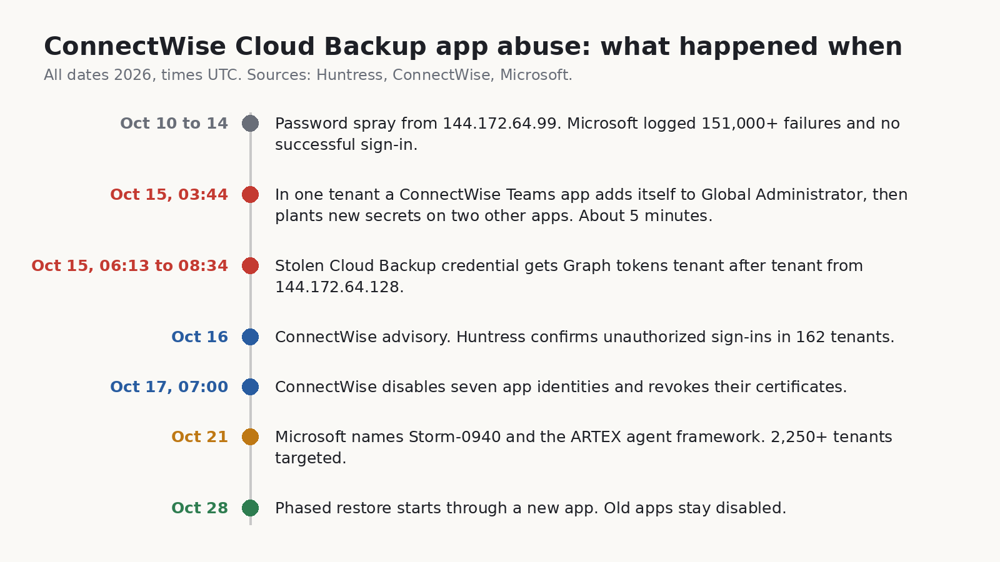
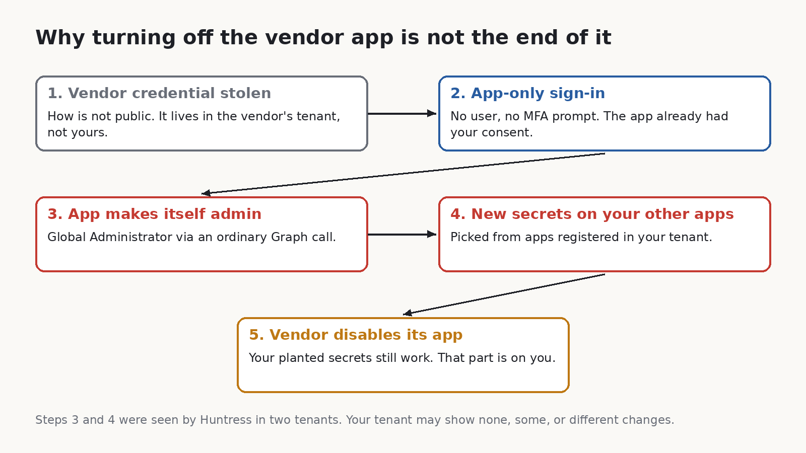
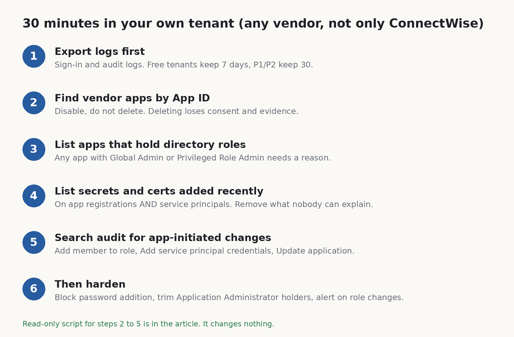

*By sudodrift*

Every Microsoft 365 tenant I've ever looked after has a few apps in it that nobody remembers adding. A backup service. A migration tool from three years ago. Something a reseller set up. They all got admin consent once, and nobody has looked at them since.

In the middle of October, one of those quiet apps woke up in other people's tenants and started doing admin work. Microsoft now says an AI agent framework was driving it. I want to walk through what's confirmed, what isn't, and then the part I actually care about: how to check your own tenant, even if you've never used ConnectWise.

## What happened

ConnectWise Cloud Backup, which used to be called SkyKick, is a backup service that MSPs use for their clients' Microsoft 365 data. To back up mail, OneDrive, SharePoint and Teams, its app gets broad read and write access in every tenant where it's installed.

On October 15, a credential belonging to that app was used from a hosting provider address (144.172.64.128) to get Microsoft Graph tokens in customer tenants. Huntress spotted it and published on October 16. By that evening they had confirmed unauthorized sign-ins in 162 tenants they could see. The credential type matters here: it was a client assertion, which is held on the vendor's side. No setting in a customer tenant could have caused that or blocked it ([Huntress, Oct 16](https://www.huntress.com/blog/vendor-credential-enables-unauthorized-access)).

The part that made me sit up was one tenant in Huntress's write-up. There, a second ConnectWise app, the Cloud Management app for Microsoft Teams, put itself into the Global Administrator role. Then a Python script added fresh client secrets to two other apps in the same tenant, one of them Huntress's own security app. The new secrets were good until 2028. The whole thing took about five minutes, starting at 03:44 UTC. A few days later Huntress found the same pattern in a second tenant, run 47 seconds after the first.

ConnectWise disabled seven of its app identities at 07:00 UTC on October 17 and revoked the certificates behind them. Its own advisory is careful to say that this stops new sign-ins through those apps but does not undo anything already changed inside a customer tenant ([ConnectWise Trust Center](https://www.connectwise.com/company/trust/advisories)). On October 28 it started a phased restore through a new app, "ConnectWise Cloud Backup for M365", that partners have to authorize tenant by tenant. By its November 4 update most features were back, and the old apps are meant to stay off.



## The AI part

On October 21, Microsoft put a name on it. It says a China-aligned group it tracks as Storm-0940 was behind the ConnectWise compromise, and that the group has been using ARTEX, an open-source framework where LLM agents run a penetration test from recon to data theft with little human input. Microsoft says the agents tried to sign in to more than 2,250 tenants with the stolen app access. Across the wider ARTEX campaign, it says there were multiple cases where the time from first targeting to privileged cloud access was under three hours ([Microsoft Security blog](https://www.microsoft.com/en-us/security/blog/2026/10/21/storm-0940-uses-artex-agentic-ai-connectwise-supply-chain-compromise/)).

Microsoft also tied an earlier password spray (October 10 to 14, from 144.172.64.99) to the same group. That spray went after 327 accounts at eight organizations, logged more than 151,000 failed sign-ins and, by Microsoft's count, zero successes. So the passwords weren't what worked. The stolen app trust was.

Huntress did something I appreciated. They went back through their own logs and asked whether it actually looked like an agent ([Huntress, Oct 26](https://www.huntress.com/blog/connectwise-attack-ai)). Their answer was careful. They saw plain scripts doing most of the work, plus something that changed the tooling between runs in under a minute. After a certificate upload failed, the next run 55 seconds later had retry logic that wasn't there before. That fits an agent loop. It also fits a quick human. On their telemetry alone they put the chance an LLM was involved at low to medium, and medium to high once you add Microsoft's attribution. They also saw a loop that kept firing for 22 minutes at a service principal that had already been deleted, which is not what you'd expect from something watching its own output.

So here's where I land, and it's an opinion, not a finding. The AI label is real enough that I'd take it seriously, but it isn't what changes your to-do list. The attack was old: steal an app's credential, use the consent the app already has, make it admin, plant more credentials so you survive the cleanup. What changes is the clock. If the gap from first touch to Global Admin is a few hours, or five minutes inside one tenant, then "we'll review it Monday" is not a plan. Huntress put it in a line I'd stick on the wall: "detect what the activity does, not how it paces itself."

## What we know and what we don't

Confirmed by the companies involved:

- A ConnectWise Cloud Backup app credential was used without authorization to get tokens in customer tenants on October 15 (Huntress, ConnectWise).
- In two tenants Huntress reviewed, a ConnectWise Teams app gave itself Global Administrator and new secrets were planted on other apps (Huntress).
- ConnectWise disabled seven app identities on October 17 and says existing backup archives show no sign of compromise (ConnectWise).
- Microsoft attributes the activity to Storm-0940 using ARTEX (Microsoft). Note that this is an intelligence assessment. Huntress says its data lines up with it but can't confirm it independently.

Not confirmed, or not public:

- How the attacker got the vendor credential in the first place. ConnectWise says it first spotted a problem on October 14 and that the root cause is still under investigation.
- What data was read. Graph directory reads leave no audit record, and Huntress said none of the victims it knows of had Graph activity logging turned on. "No mailbox changes in the log" is not the same as "nothing taken".
- The full list of affected tenants. Microsoft's 2,250 is attempted sign-ins. Huntress only sees its own customers.

## Why switching off the vendor app isn't the end

This is the bit I'd explain to a manager. When the vendor revokes its credential, the front door closes. But if the attacker already used admin rights to add a secret to one of your other apps, that secret is a separate key. It signs in as that other app, from anywhere, with no user and no MFA prompt. Disabling ConnectWise does nothing to it.



That's why this matters even if you never bought ConnectWise. Any multi-tenant app you've consented to with high permissions is the same shape of risk. Backup, migration, compliance, email security, the MSP's management tool. If you can't list them right now, that's the first finding.

## Check your tenant

Here's what I'd do, in this order. I've kept it to things a small team can do with the licences they already have.



1. Save the logs before you touch anything. Entra keeps sign-in and audit logs for 7 days on the free tier and 30 days with P1 or P2 ([Microsoft Learn](https://learn.microsoft.com/en-us/entra/identity/monitoring-health/reference-reports-data-retention)). October 15 was 21 days ago. If you're on the free tier, the key day has already rolled off and nothing will bring it back. If you're on P1/P2, export now from Monitoring > Audit logs and the Service principal sign-ins tab. That window closes around November 14.

2. Look for the ConnectWise apps by App ID, not by name. Older tenants may show them as "SkyKick Cloud Manager". The IDs Huntress and ConnectWise published:

```
506e08f9-6e9a-4da4-942b-a099a03644ae  ConnectWise Cloud Backup
2399d300-6fca-4e6a-a686-399fefe75b83  ConnectWise Cloud Management
24205314-2b89-4e07-a2a4-579e898a5640  Cloud Management - MS Teams
b78f6a77-d4e5-46fb-87e5-d1648bd02519  Cloud Management - Exchange Online
0de14c77-b9b0-4137-9360-34878a929827  Cloud Management - MS Graph
412dcf96-176d-4b3a-a1b0-4981ad66971e  Cloud Management - Partner Center
b2b55f5b-7758-4719-8d8f-88ae172e6bdb  Cloud Management - SharePoint Online
```

If you find one, set "Enabled for users to sign-in" to No under the enterprise app's Properties. Don't delete it. Microsoft and Huntress both say the same thing here: deleting throws away the consent and evidence you may need. And don't turn the old apps back on. ConnectWise's restore goes through a new app.

3. List every app that holds a directory role. In most small tenants this list should be short and boring. An app sitting in Global Administrator, Privileged Role Administrator, Application Administrator or Cloud Application Administrator needs a written reason. If it was put there recently and nobody on your team did it, treat that as an incident.

4. List every secret and certificate added recently. Check both app registrations and service principals. Secrets can live on either, and one added straight to a service principal won't appear on the app registration's Certificates and secrets page, so clicking around the portal can miss it. For each one added since about October 13, ask who made it. If nobody can say, remove it and rotate whatever that app could reach.

5. Search the audit log for changes started by an app, not a person. The events to look for are "Add member to role", "Add service principal credentials" and the "Update application" entries for certificates and secrets. In a normal tenant, an app adding itself to a role or editing other apps is rare enough that every hit is worth reading. Huntress noted the vendor's normal traffic used a .NET SDK user agent (kiota-dotnet), while the changes they saw came from Python-urllib/3.12. A mismatch like that is a good lead, though not proof on its own.

I wrote a read-only PowerShell script that does steps 2 to 5 in one go. It uses the Microsoft Graph PowerShell SDK, asks for read scopes only, and prints four tables. It changes nothing. Here is the core of it (the full file is linked at the end, and it's worth trying in a test tenant first):

```powershell
Connect-MgGraph -NoWelcome -Scopes 'Application.Read.All','RoleManagement.Read.Directory','AuditLog.Read.All'

# Apps that hold a directory role
$roleNames = @{}
Get-MgRoleManagementDirectoryRoleDefinition -All -Property 'id,displayName' |
    ForEach-Object { $roleNames[$_.Id] = $_.DisplayName }
Get-MgRoleManagementDirectoryRoleAssignment -All -ExpandProperty 'principal' |
    Where-Object { $_.Principal.AdditionalProperties['@odata.type'] -eq '#microsoft.graph.servicePrincipal' } |
    ForEach-Object { '{0,-35} {1}' -f $roleNames[$_.RoleDefinitionId], $_.Principal.AdditionalProperties['displayName'] }

# Secrets and certificates added since a date, on service principals
$since = [datetime]'2026-10-13'
Get-MgServicePrincipal -All -Property 'id,appId,displayName,passwordCredentials,keyCredentials' |
    ForEach-Object {
        $sp = $_
        @($sp.PasswordCredentials) + @($sp.KeyCredentials) |
            Where-Object { $_ -and $_.StartDateTime -ge $since } |
            ForEach-Object { '{0:u}  {1}' -f $_.StartDateTime, $sp.DisplayName }
    }

# Audit events where an app (not a user) added someone to a role
Get-MgAuditLogDirectoryAudit -All -Filter "activityDateTime ge 2026-10-13T00:00:00Z and activityDisplayName eq 'Add member to role'" |
    Where-Object { $_.InitiatedBy.App.AppId } |
    Select-Object ActivityDateTime, @{n='ByApp';e={$_.InitiatedBy.App.DisplayName}}, Result
```

Honest limits. I checked that it parses and that the cmdlets and parameters exist in the current Graph modules, but I haven't run it against a tenant hit by this incident, because I don't have one. Credential start dates can be set by whoever creates the credential, so don't treat "nothing recent" as a clean bill. The audit log is the better witness, if you still have it. And role assignments that are only PIM-eligible won't show in the role list. In a small tenant that's usually fine. In a bigger one, check PIM too.

If you hold the Defender XDR or Sentinel licences, Microsoft's post has ready-made hunting queries that join service principal sign-ins with Graph activity. Use those. My script is for the tenants that don't have them, which in my experience is most small ones.

## Then make the next one slower

None of this stops a vendor from losing its own credential. It just makes what an attacker can do with it smaller and noisier.

- Block new client secrets. In the Entra admin center, go to Enterprise apps > Application policies > Block password addition and switch it on for all applications ([Microsoft Learn](https://learn.microsoft.com/en-us/entra/identity/enterprise-apps/configure-app-management-policies)). Test it first. Some of your own automation may still create secrets, and you can exempt specific apps. It won't stop certificates, and a Global Admin can switch it off, but it removes the cheapest way to plant a key.
- Shrink who can edit apps. Count the people and apps holding Application Administrator and Cloud Application Administrator. Each one can add credentials to apps. Most small tenants need one or two at most.
- Get an alert, not a report. If you have P1 or P2 but no Sentinel, you can still send audit logs to a Log Analytics workspace and alert on "Add member to role" where the initiator is an app. The point is that someone's phone buzzes within minutes, because that's the timescale now.
- Turn on Graph activity logs if you can. It's the one log that would have shown what was read, and Huntress said nobody they knew had it on.
- Ask your vendors one question. "Which permissions does your app hold in our tenant, and which of them do you actually use?" A backup app needs to read mail. It almost certainly doesn't need to grant directory roles. If the answer is vague, that tells you something.

On Linux boxes I keep a baseline of who has sudo and which SSH keys exist, and I diff it, which is why I built [sudodrift](https://github.com/sudodrift/sudodrift). It doesn't touch Entra and won't help with this incident directly. But the habit carries over: write down which apps hold roles and secrets today, save it, and compare next week. You can't spot a new key if you never knew the old list.

## Sources

- Huntress, "ConnectWise (SkyKick) Vendor Credentials Abused in M365 Attacks" (Oct 16, updated through Oct 27): https://www.huntress.com/blog/vendor-credential-enables-unauthorized-access
- Huntress, "AI, Scripts, Operator: Inside the ConnectWise Attack" (Oct 26): https://www.huntress.com/blog/connectwise-attack-ai
- Microsoft Security, "AI-driven, large-scale nation-state campaign using ARTEX enables supply chain compromise" (Oct 21): https://www.microsoft.com/en-us/security/blog/2026/10/21/storm-0940-uses-artex-agentic-ai-connectwise-supply-chain-compromise/
- ConnectWise Trust Center advisory, Cloud Backup (Oct 16, updated through Nov 4): https://www.connectwise.com/company/trust/advisories
- ConnectWise, Cloud Backup technical investigation and remediation guide (Oct 18): https://www.connectwise.com/contentassets/10777cd3364d440c86ed5270a94a5f24/connectwise-cloud-backup-technical-investigation-and-remediation-guide-1.pdf
- Cybersecurity Dive coverage: https://www.cybersecuritydive.com/news/china-nexus-actor-attack-connectwise-cloud-backup/833727/
- Microsoft Learn, Entra data retention: https://learn.microsoft.com/en-us/entra/identity/monitoring-health/reference-reports-data-retention
- Microsoft Learn, app management policies: https://learn.microsoft.com/en-us/entra/identity/enterprise-apps/configure-app-management-policies

Full script (read-only, it changes nothing): [vendor-app-check.ps1 on GitHub](https://github.com/sudodrift/sudodrift.github.io/blob/main/assets/posts/vendor-app-global-admin/vendor-app-check.ps1). Read it before you run it, and try it in a test tenant first.

*All images are original drawings by sudodrift.*
