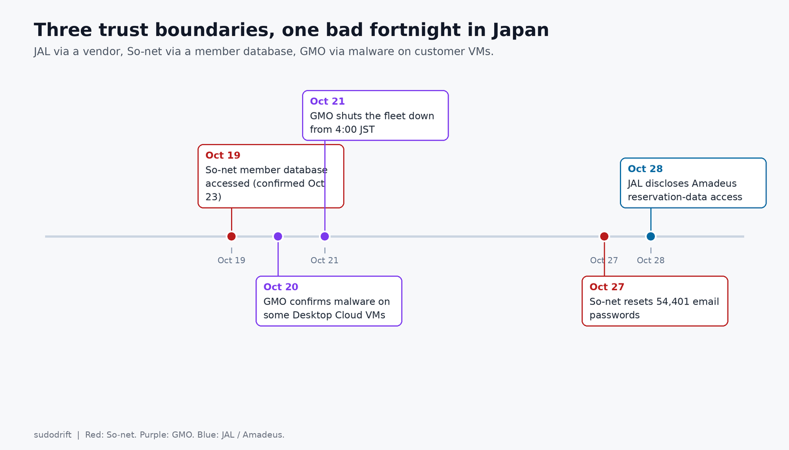
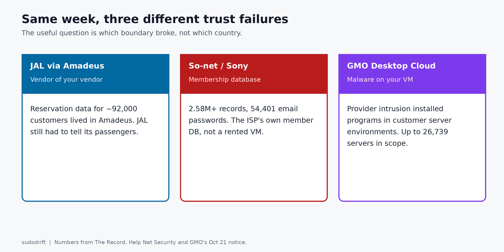
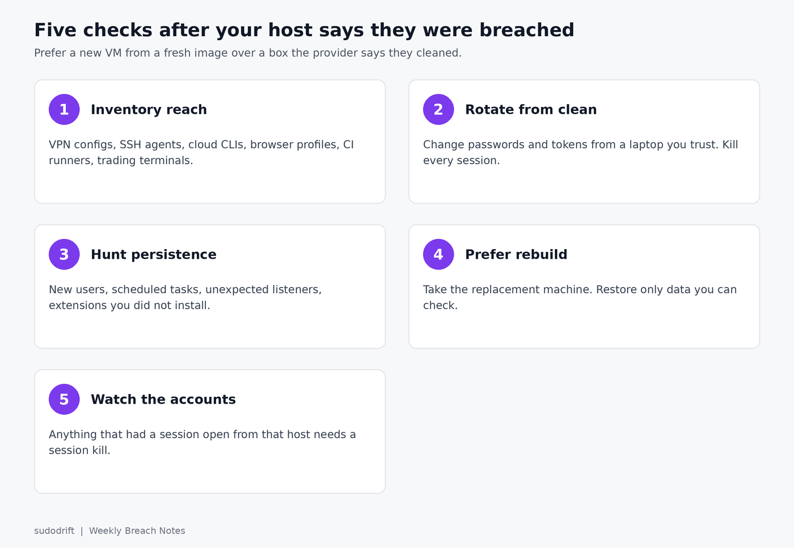

*By sudodrift*

On October 28 The Record [summarized](https://therecord.media/japan-airlines-warns-of-breach-country-grapples-with-incidents) a pile-up of Japanese incidents that has the prime minister talking about emergency measures. I am not going to re-report every one. Three of them share a shape that matters to anyone who rents a server from somebody else.

## Three incidents, three trust boundaries

**Japan Airlines, via Amadeus.** JAL said Amadeus, which runs its reservation, ticketing and check-in systems, told it that attackers accessed a portion of customer reservation data. About 92,000 customers were affected. For about 2,000 of them the data included passport numbers, frequent flyer numbers, email addresses and phone numbers. Flight operations and card numbers were not hit. The breached system was a vendor's, not JAL's own data center. The data was still JAL's customers.

**Sony Network Communications / So-net.** Help Net Security's [write-up](https://www.helpnetsecurity.com/2026/10/28/sony-network-communications-data-breach-so-net/) of the company notice: attackers hit the So-net member database on October 19, confirmed October 23. More than 2.58 million current and former customer records (names, phones, emails, user IDs, dates of birth, gender, connection IDs), plus 54,401 email addresses with their passwords, plus 16 bank account records without PINs. Passwords on the email side were reset October 27. NURO and other services were not in the leak, per Sony.

**GMO Onamae.com Desktop Cloud.** GMO's own [October 21 notice](https://internet.gmo/en/news/article/246) says a third party installed malicious programs in some customers' server environments. Up to 26,739 servers were potentially affected. The company shut the fleet down starting 4:00 JST on October 21. Later reporting (TechRadar citing BleepingComputer) says attackers demanded roughly $50 million, GMO refused, data leaked, and customers were told to scan, back up, disconnect and shut down their own PCs. Login credentials for MetaTrader 4 and 5 were among what was taken, and some customers reported trades they did not recognize. I have not independently confirmed the ransom figure from GMO's own English notices; treat that number as coming from secondary reporting.

## The angle that travels

JAL is a vendor-of-your-vendor story. So-net is a membership-database story. GMO is the one that should change how you think about a rented desktop or VPS: the provider's intrusion became malware on the customer's server.

If you rent a machine from anyone, the question after their incident is not "did they rotate their keys." It is "what do I still trust on the box they handed back."

## What I would check on my own servers

Assume the provider's timeline is incomplete. Work from the box you can still reach, or from the replacement they gave you.

1. **Inventory what the box could reach.** Outbound VPN configs, SSH agent sockets, cloud CLI profiles, browser profiles, saved RDP files, trading-platform terminals, CI runner registrations. Anything with a credential that still works after the host is "cleaned."
2. **Rotate from a clean machine.** Do not rotate from the rented desktop. From a laptop you trust, change every password and token that lived on that host, end every session, and revoke every API key. GMO's own notice told customers to change credentials stored on the server and anywhere they reused them. That is the floor, not the ceiling.
3. **Look for what the malware left.** New local users, new scheduled tasks or systemd units, unexpected listening ports, browser extensions you did not install, outbound connections to places that are not your broker. On a Windows rented desktop, Autoruns and a full offline AV scan; on Linux, the usual persistence places plus `dpkg --verify` / `rpm -V` for system packages.
4. **Treat "we cleaned it" as unproven.** Prefer a new VM from a fresh image, then restore only the data you can check. If the provider offers a replacement machine, take it.
5. **Watch the accounts that ran there.** MetaTrader customers saw unrecognized trades. SaaS accounts that had a session open from that host need a session kill and a password change, even if the provider says the data did not include those passwords.

## For the Friday roundup

These three sit next to Burger King Japan (about 11 million) and Capcom (about 11.7 million) in The Record's roundup. The hosting angle is the one worth a full note; the others are volume. Capcom and Burger King numbers are from The Record's summary, which does not link their primary notices in the same piece, so confirm those against the companies' own statements before you lean on the figures.

## Sources

- The Record, [Japan Airlines warns of data breach as country grapples with multiple cyber incidents](https://therecord.media/japan-airlines-warns-of-breach-country-grapples-with-incidents), October 28, 2026
- Help Net Security, [Data breach at Sony-owned internet provider compromises 2.6 million customer records](https://www.helpnetsecurity.com/2026/10/28/sony-network-communications-data-breach-so-net/), October 28, 2026
- GMO Internet, [Apology and Notice Regarding Unauthorized Access to Onamae.com Desktop Cloud](https://internet.gmo/en/news/article/246), October 21, 2026
- TechRadar, [Japanese internet giant GMO tells customers to shut down](https://www.techradar.com/pro/security/japanese-internet-giant-gmo-tells-customers-to-shut-down-and-disconnect-pcs-from-the-internet-following-data-breach-and-ransomware-threat), October 28, 2026 (secondary source for the ransom demand and MetaTrader detail)
